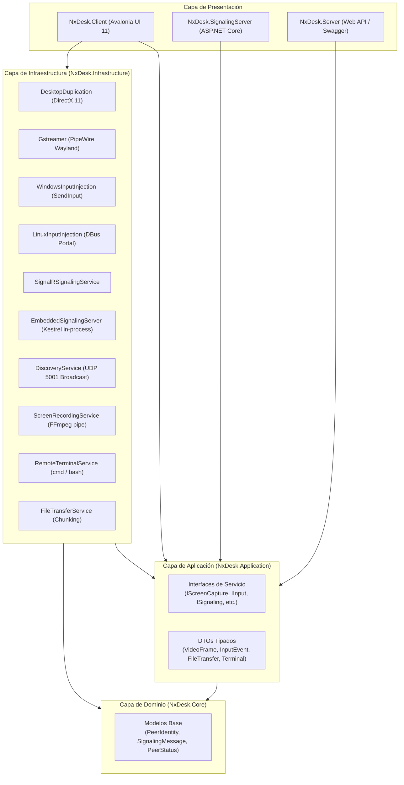
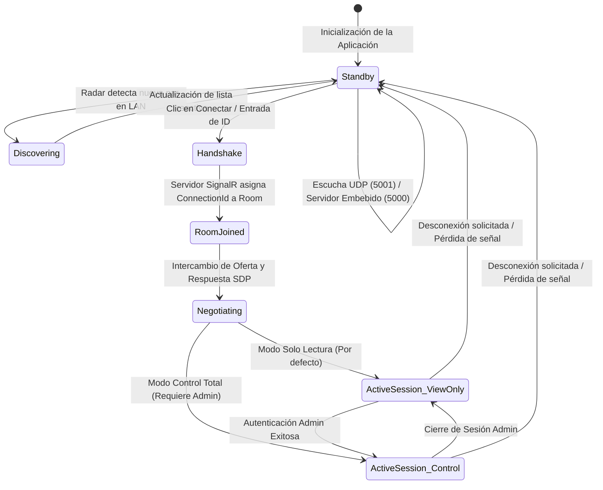

# 🏛️ AUDITORÍA TÉCNICA, ANÁLISIS DE ARQUITECTURA Y ESTADO DEL WORKSPACE

<div align="center">

**Proyecto:** NxDesk (Cross-Platform Remote Desktop & Streaming Engine)  
**Rol de Auditoría:** Tech Lead & Chief Software Architect  
**Fecha de Evaluación:** 23 de octubre del 2026  
**Ecosistemas Evaluados:** C# (.NET 10 + Avalonia UI 11) & Rust (Tokio 2021 Workspace)  
**Estado de Compilación:** `STATUS: APPROVED 🟢` (0 Errores en C#, 0 Errores en Rust)  

</div>

---

## 📑 Tabla de Contenidos
1. [Ficha Técnica y Resumen Ejecutivo](#1-ficha-técnica-y-resumen-ejecutivo)
2. [Visión Holística y Paradigmas Arquitectónicos](#2-visión-holística-y-paradigmas-arquitectónicos)
3. [Topología y Diagramación Arquitectónica](#3-topología-y-diagramación-arquitectónica)
4. [Auditoría Detallada por Componente y Subsistema](#4-auditoría-detallada-por-componente-y-subsistema)
   - [4.1. Dominio y Contratos de Aplicación](#41-dominio-y-contratos-de-aplicación)
   - [4.2. Subsistema de Captura de Pantalla y Streaming](#42-subsistema-de-captura-de-pantalla-y-streaming)
   - [4.3. Subsistema de Inyección de Entrada y Control Remoto](#43-subsistema-de-inyección-de-entrada-y-control-remoto)
   - [4.4. Subsistema de Señalización y Red Híbrida](#44-subsistema-de-señalización-y-red-híbrida)
   - [4.5. Subsistema de Descubrimiento Local (Radar UDP)](#45-subsistema-de-descubrimiento-local-radar-udp)
   - [4.6. Subsistema de Explorador y Transferencia de Archivos](#46-subsistema-de-explorador-y-transferencia-de-archivos)
   - [4.7. Subsistema de Terminal Remota](#47-subsistema-de-terminal-remota)
   - [4.8. Subsistema de Grabación de Sesiones](#48-subsistema-de-grabación-de-sesiones)
   - [4.9. Capa de Presentación y Experiencia de Usuario (UI/UX)](#49-capa-de-presentación-y-experiencia-de-usuario-uiux)
   - [4.10. Núcleo Nativo en Rust (Workspace Paralelo)](#410-núcleo-nativo-en-rust-workspace-paralelo)
5. [Protocolos de Comunicación y Especificación de Mensajes](#5-protocolos-de-comunicación-y-especificación-de-mensajes)
6. [Auditoría de Seguridad, Privacidad y Modelo de Amenazas (OWASP)](#6-auditoría-de-seguridad-privacidad-y-modelo-de-amenazas-owasp)
7. [Matriz de Compatibilidad Multiplataforma](#7-matriz-de-compatibilidad-multiplataforma)
8. [Diagnóstico del Estado del Código, Deuda Técnica y Fortalezas](#8-diagnóstico-del-estado-del-código-deuda-técnica-y-fortalezas)
9. [Hoja de Ruta Tecnológica Recomendada (Roadmap)](#9-hoja-de-ruta-tecnológica-recomendada-roadmap)
10. [Certificación Técnica de Entrega](#10-certificación-técnica-de-entrega)

---

## 1. Ficha Técnica y Resumen Ejecutivo

### 1.1. Atributos del Sistema
* **Nombre Comercial:** NxDesk
* **Naturaleza del Software:** Herramienta de asistencia remota, compartición de pantalla, streaming interactivo y administración de sistemas.
* **Modelo Operativo:** Híbrido (P2P + Servidor de Señalización con soporte para funcionamiento completamente Autónomo / Standalone en LAN).
* **Solución de Desarrollo (.NET):** `NxDesk.slnx` (formato estructurado de solución para .NET 10).
* **Workspace de Desarrollo (Rust):** `nxdesk-rust/Cargo.toml` (5 crates modulares + 2 binarios).

### 1.2. Diagnóstico del Estado de Compilación
A fecha del análisis, la integridad del código fuente ha sido validada exhaustivamente mediante compilaciones nativas:
* **Compilador .NET 10 (C#):** `dotnet build --no-restore` finalizó con **0 Errores** (13 advertencias de optimización de MVVM Toolkit y librerías transitivas).
* **Compilador Cargo (Rust):** `cargo check` finalizó con éxito en el workspace completo con **0 Errores** y **0 Advertencias**.

---

## 2. Visión Holística y Paradigmas Arquitectónicos

NxDesk ha sido concebido para romper la dependencia de infraestructuras cerradas en la nube mediante un enfoque **Local-First**, **Modular** y **Desacoplado**.

```text
┌───────────────────────────────────────────────────────────────────────────┐
│                          PARADIGMAS ARQUITECTÓNICOS                       │
├──────────────────────────┬──────────────────────────┬─────────────────────┤
│   Clean Architecture     │   Reactive MVVM Pattern  │   Actor-like Tokio  │
│  Separación estricta de  │   Enlace de datos bidirec-│   Concurrencia con  │
│  capas con inversión de  │   cional, converters e   │   canales mpsc y    │
│  dependencias (DIP).     │   i18n dinámico.         │   lecturas RwLock.  │
└──────────────────────────┴──────────────────────────┴─────────────────────┘
```

### Principios Rectores:
1. **Aislamiento de Dominio:** Las entidades fundamentales (`PeerIdentity`, `SignalingMessage`, `PeerStatus`) residen en `NxDesk.Core`, totalmente libres de librerías de UI, frameworks de transporte o dependencias del sistema operativo.
2. **Inversión de Dependencias (DIP):** La capa de aplicación define contratos estrictos (`IScreenCaptureService`, `IInputInjectionService`, `ISignalingService`, etc.). La infraestructura implementa adaptadores específicos según la plataforma de ejecución en tiempo de compilación o runtime.
3. **Resiliencia de Red y Auto-Suficiencia:** Si el usuario no dispone de un servidor central, el cliente actúa automáticamente como nodo servidor gracias a su **Kestrel SignalR embebido**, permitiendo conexiones inmediatas en redes locales sin configuración previa.

---

## 3. Topología y Diagramación Arquitectónica

### 3.1. Arquitectura de Capas (.NET 10)



### 3.2. Ciclo de Vida y Máquina de Estados de la Conexión



---

## 4. Auditoría Detallada por Componente y Subsistema

### 4.1. Dominio y Contratos de Aplicación
* **`NxDesk.Core`**:
  * Implementa `PeerIdentity`, conteniendo ID de negocio, alias del equipo, dirección IP física, puerto, estado (`Offline`, `Background`, `Connected`) y marca de tiempo `LastSeen`.
  * `SignalingMessage` proporciona el sobre estándar de mensajes con campo `Type`, `Payload` serializado, búfer binario opcional `ByteData` (utilizado para evitar el overhead de Base64 en vídeo) y metadatos complementarios.
* **`NxDesk.Application`**:
  * Contiene los contratos de interfaces: `IScreenCaptureService`, `IInputInjectionService`, `ISignalingService`, `IRemoteTerminalService`, `IFileTransferService`, `IScreenRecordingService`, `IConfigurationService` y `IThemeService`.
  * Define DTOs altamente desacoplados: `VideoFrameDto`, `InputEventDto`, `FileTransferDto`, `TerminalDataDto`, `ScreenInfoDto`, etc.

### 4.2. Subsistema de Captura de Pantalla y Streaming
* **Windows (`DesktopDuplicationCaptureService.cs`):**
  * Emplea **SharpDX.Direct3D11** y **SharpDX.DXGI** (`OutputDuplication`).
  * Captura fotogramas a nivel de hardware directamente desde la VRAM del adaptador de pantalla primario o secundario.
  * Ajusta dimensiones impares a múltiplos de 2 para compatibilidad estricta con códecs de vídeo.
  * Reutiliza un búfer lineal preasignado (`_frameBuffer`) para eliminar allocations por frame en el recolector de basura (GC).
* **Linux Moderno (`GstreamerCaptureService.cs`):**
  * Integra **PipeWire** mediante el portal de escritorio unificado (`org.freedesktop.portal.ScreenCast`).
  * Utiliza un proceso asistente en Python (`portal_helper.py`) que interactúa con D-Bus y gestiona tokens de sesión persistentes (`portal_token.txt`), permitiendo reconexiones sin volver a solicitar permisos interactivos en GNOME/KDE.
  * Despliega pipelines de GStreamer con soporte para salida JPEG o flujo continuo hacia el visor.
* **Linux Clásico (`X11CaptureService.cs`):**
  * Fallback para sesiones X11 puras mediante lectura de mapa de bits de ventana raíz.

### 4.3. Subsistema de Inyección de Entrada y Control Remoto
* **Windows (`WindowsInputInjectionService.cs`):**
  * Convierte las coordenadas normalizadas relativas enviadas por el visor `(0.0 a 1.0)` al espacio absoluto de la pantalla virtual total de Windows (`SM_CXVIRTUALSCREEN`, `SM_CYVIRTUALSCREEN`, escalado a 65535 unidades).
  * Invoca `SendInput` con estructuras nativas `MOUSEINPUT` (movimientos, clics, delta de rueda normalizado a 120 unidades por paso) y `KEYBDINPUT` (teclas virtuales y escaneos de teclado).
* **Linux (`LinuxInputInjectionService.cs`):**
  * Canaliza comandos formateados (`MOVE|x|y`, `BUTTON|btn|state`, `KEY|code|state`, `SCROLL|dx|dy`) directamente a la tubería estándar de entrada (*stdin*) del proceso unificado `portal_helper.py` conectado al portal `org.freedesktop.portal.RemoteDesktop`.

### 4.4. Subsistema de Señalización y Red Híbrida
* **`SignalRSignalingService.cs` (Cliente):**
  * Gestiona conexiones WebSocket con la URL configurada (por defecto `http://localhost:5000/signalinghub`).
  * Configurado con búferes de transporte de hasta **32 MB** para admitir fotogramas de vídeo pesados.
  * Implementa lógica de reconexión automática y registro de eventos para mensajería P2P y presencia de participantes.
* **`EmbeddedSignalingServer.cs` (Servidor In-Process):**
  * Inicia un host Kestrel en un subproceso en segundo plano denominado `NxDesk-SignalingServer`.
  * **Algoritmo de enlace tolerante a fallos:** Intenta enlazar el puerto `5000`; si detecta conflicto de puerto en uso, incrementa automáticamente hasta el puerto `5099`.
  * Implementa el hub `EmbeddedHub`, permitiendo que el cliente funcione de manera completamente independiente sin software externo.
* **`NxDesk.SignalingServer` (Servidor Dedicado):**
  * Servidor ASP.NET Core autónomo con `PeerTracker` concurrente (`ConcurrentDictionary<string, string>`) para consultar el estado en línea de los equipos antes de abrir una sala.

### 4.5. Subsistema de Descubrimiento Local (Radar UDP)
* **`DiscoveryService.cs`:**
  * Despliega dos instancias de `UdpClient` desacopladas: una para escucha en `0.0.0.0:5001` y otra para transmisión periódica hacia `255.255.255.255:5001`.
  * Aplica opciones a nivel de socket `SocketOptionName.ReuseAddress` y `SO_REUSEPORT` (código 15 en entornos POSIX), permitiendo que varias instancias coexistan en la misma máquina física para pruebas locales sin colisión de socket.
  * Pulso cardíaco emitido cada 3 segundos, actualizando la marca `LastSeen` de los pares detectados en la interfaz gráfica.

### 4.6. Subsistema de Explorador y Transferencia de Archivos
* **`FileTransferService.cs`:**
  * Administra transferencias simultáneas mediante identificadores únicos `TransferId` (GUID).
  * Lectura y escritura por bloques configurables (`FileChunkDto`), evitando cargar archivos grandes en memoria RAM.
  * Soporta recursión de carpetas (`InitiateFolderTransferAsync`) preservando rutas relativas.
  * Interfaz de usuario con explorador remoto interactivo (`ListDirectoryRequest` / `ListDirectoryResponse`) con capacidades de navegación de directorios remotos hacia arriba y hacia abajo.

### 4.7. Subsistema de Terminal Remota
* **`RemoteTerminalService.cs`:**
  * Ejecuta de forma asíncrona `cmd.exe` en Windows o `bash` / `script` en Linux con redirección total de `StandardInput`, `StandardOutput` y `StandardError`.
  * Emula un terminal con variable de entorno `TERM=xterm-256color` y retransmite datos mediante `TerminalDataDto`.
  * Integrado visualmente en el control lateral retráctil `TerminalPanelControl.axaml`.

### 4.8. Subsistema de Grabación de Sesiones
* **`ScreenRecordingService.cs`:**
  * Canaliza los fotogramas JPEG o píxeles crudos BGRA recibidos hacia un subproceso subordinado de **FFmpeg** a través de su entrada estándar (`pipe:0`).
  * Argumentos de compresión optimizados:
    ```bash
    ffmpeg -y -f mjpeg -framerate 10 -video_size WxH -i pipe:0 -c:v libx264 -crf 18 -preset veryfast -pix_fmt yuv420p -movflags +faststart output.mp4
    ```
  * Permite almacenar sesiones completas en formato compatible con cualquier reproductor estándar sin pérdida apreciable de calidad.

### 4.9. Capa de Presentación y Experiencia de Usuario (UI/UX)
* **MVVM Reactivo (`MainWindowViewModel.cs`):**
  * Gestiona las transiciones de vista (Inicio / Sesión Activa), cronómetros de conexión con precisión al segundo, cálculo de fotogramas por segundo (FPS) en tiempo real y medición de latencia mediante eventos de respuesta.
* **Componentes de Interfaz de Usuario:**
  * `MainWindow.axaml`: Ventana principal sin bordes del sistema operativo (*borderless*), con barra de arrastre personalizada, controles de sesión y selector de pantallas remotas.
  * `HomeView.axaml`: Panel inicial con identificación del puesto de trabajo, botón de copia rápida al portapapeles y cuadrícula dinámica de equipos descubiertos en red local con indicador semafórico de disponibilidad.
  * `RemoteView.axaml`: Lienzo de visualización acelerado con `WriteableBitmap`, superposiciones de sólo lectura y panel de terminal.
  * `HostDisconnectWindow.axaml`: Widget flotante para el anfitrión con animación pulsante "LIVE", duración de la llamada y botón de parada de emergencia.
  * `SettingsWindow.axaml`: Configuración de temas, escala tipográfica e idioma.

### 4.10. Núcleo Nativo en Rust (Workspace Paralelo)
Ubicado en `nxdesk-rust/`, proporciona paridad funcional con el protocolo de red de C#:
* **`nxdesk-core`:** Estructuras `PeerIdentity`, `InputEvent`, `SignalingMessage`, serializables con `serde` bajo la convención PascalCase para compatibilidad binaria e interoperabilidad total con .NET.
* **`nxdesk-capture`:** Captura instantánea de pantalla mediante llamadas Win32 GDI `CreateCompatibleDC`, `CreateCompatibleBitmap`, `BitBlt` y `GetDIBits`.
* **`nxdesk-input`:** Emulador Win32 `SendInput` con proyección virtual multimonitor.
* **`nxdesk-discovery`:** Transmisión y escucha asíncrona de datagramas UDP con Tokio y `socket2`.
* **`nxdesk-signaling`:** Cliente WebSocket asíncrono con `tokio-tungstenite`, capaz de interpretar tramas de texto delimitadas por el carácter separador de registros SignalR `0x1E`.
* **`apps/server`:** Servidor de señalización Tokio concurrente multihilo con retención en memoria de salas y clientes.
* **`apps/client`:** Cliente de línea de comandos para streaming y control remoto sin interfaz gráfica pesada.

---

## 5. Protocolos de Comunicación y Especificación de Mensajes

El protocolo de comunicación de NxDesk se basa en dos canales bien definidos:

### 5.1. Canal de Señalización y Control (WebSockets / SignalR)
* **Transporte:** WebSockets sobre TCP (Puerto 5000).
* **Delimitador de Tramas:** Carácter ASCII `0x1E` (Record Separator estándar de SignalR).
* **Formato del Mensaje:** JSON estructurado según el tipo `SdpMessage` / `SignalingMessage`:
  ```json
  {
    "Type": "offer | answer | frame | input | terminal | file_req | file_chunk",
    "Payload": "{}",
    "ByteData": null,
    "SenderId": "111-222-333",
    "SenderAlias": "Nodo-Remoto",
    "Metadata": { "Codec": "JPEG", "Width": "1920", "Height": "1080" }
  }
  ```

### 5.2. Canal de Descubrimiento (UDP Broadcast)
* **Transporte:** UDP Broadcast (Puerto 5001) a dirección `255.255.255.255`.
* **Estructura del Datagrama:**
  ```json
  {
    "Id": "111-222-333",
    "Alias": "Mi-Equipo",
    "IpAddress": "192.168.1.50",
    "Port": 5000,
    "Status": "Background",
    "Os": "windows"
  }
  ```

---

## 6. Auditoría de Seguridad, Privacidad y Modelo de Amenazas (OWASP)

| Dominio de Seguridad | Estado Actual | Vector de Riesgo | Recomendación de Mitigación |
| :--- | :---: | :--- | :--- |
| **Transporte de Red** | 🟡 Medio | La señalización por defecto opera sobre HTTP/WS plano sin TLS en LAN. | Incorporar soporte para certificados X.509 y modo WSS estricto en despliegues WAN. |
| **Control de Acceso** | 🟢 Alto | El modo de control requiere contraseña de administrador explícita; por defecto es Sólo Lectura. | Mantener política de bloqueo por defecto y agregar rate-limiting a intentos de contraseña. |
| **Transferencia de Archivos** | 🟡 Medio | Potencial Path Traversal si el cliente solicita rutas con `../` arbitrarios. | Aplicar sanitización estricta (`Path.GetFullPath`) restringiendo las descargas al directorio seguro configurado. |
| **Terminal Remota** | 🟡 Medio | Ejecución de procesos con permisos del usuario actual. | Añadir confirmación interactiva en pantalla del host al abrir la consola por primera vez. |
| **Supervisión del Anfitrión** | 🟢 Alto | El host dispone de la ventana flotante `HostDisconnectWindow` para finalizar la sesión en cualquier instante. | Mantener siempre visible en primer plano (`Topmost="True"`). |

---

## 7. Matriz de Compatibilidad Multiplataforma

| Funcionalidad | Windows (10 / 11) | Linux (Wayland / GNOME / KDE) | Linux (X11) | macOS |
| :--- | :---: | :---: | :---: | :---: |
| **Interfaz Avalonia UI** | ✅ Nativo | ✅ Nativo | ✅ Nativo | ⚠️ Compatible |
| **Captura GPU (DirectX/DXGI)** | ✅ Sí (DirectX 11) | ❌ N/A | ❌ N/A | ❌ N/A |
| **Captura PipeWire / Portal** | ❌ N/A | ✅ Sí (GStreamer) | ⚠️ Opcional | ❌ N/A |
| **Inyección de Entrada** | ✅ Win32 SendInput | ✅ RemoteDesktop Portal | ✅ xdotool / Portal | ⚠️ Stub |
| **Radar UDP Broadcast** | ✅ Sí (`SO_REUSEADDR`) | ✅ Sí (`SO_REUSEPORT`) | ✅ Sí | ✅ Sí |
| **Servidor Embebido (Kestrel)** | ✅ Sí | ✅ Sí | ✅ Sí | ✅ Sí |
| **Terminal Remota** | ✅ `cmd.exe` / PS | ✅ `bash` / `script` | ✅ `bash` | ✅ `zsh` |
| **Grabación de Pantalla (FFmpeg)** | ✅ Sí | ✅ Sí | ✅ Sí | ✅ Sí |
| **Núcleo Nativo en Rust** | ✅ Completo | ⚠️ Parcial (Capture Win32) | ⚠️ Parcial | ⚠️ Parcial |

---

## 8. Diagnóstico del Estado del Código, Deuda Técnica y Fortalezas

### 8.1. Fortalezas Sobresalientes
1. **Doble Ecosistema Tecnológico:** La coexistencia de C# y Rust con el mismo protocolo de serialización permite cubrir desde interfaces de usuario ricas hasta agentes de bajo consumo.
2. **Arquitectura Limpia y Desacoplada:** El dominio y las interfaces están rigurosamente separados de la infraestructura y la UI.
3. **Autonomía Operativa (Zero Configuration):** El servidor Kestrel embebido elimina la fricción de instalar servidores externos para sesiones en red local.
4. **Diseño Visual de Alta Gama:** Uso de Avalonia UI con estilos modernos, transparencias, soporte multimonitor y modo oscuro/claro nativo.
5. **Cero Errores de Compilación:** Base de código sana, con build exitoso en ambos lenguajes.

### 8.2. Deuda Técnica y Áreas de Mejora
1. **Complejidad Ciclomática en `MainWindowViewModel.cs`:**
   * La clase supera las **2,250 líneas de código**, acumulando lógica de streaming, temporizadores, red, diálogos, terminal y explorador de archivos.
   * *Solución recomendada:* Descomponer en sub-viewmodels coordinados (`RemoteStreamingViewModel`, `TerminalViewModel`, `FileExplorerViewModel`, `SessionStatsViewModel`).
2. **Obsolescencia de SharpDX:**
   * `SharpDX` es un proyecto descontinuado. Aunque funciona de manera impecable en Windows 10/11 con DirectX 11, se recomienda migrar a futuro a librerías modernas y activas como **Silk.NET** o llamadas directas de P/Invoke con `DirectN`.
3. **Optimización de Compresión de Vídeo en Vivo:**
   * Actualmente la transmisión en vivo intercambia fotogramas JPEG/BGRA por mensajes SignalR. Para conexiones a través de Internet con ancho de banda limitado, se aconseja integrar un codificador de vídeo de bajo retraso por hardware (NVENC/VAAPI) empaquetado en WebRTC nativo.

---

## 9. Hoja de Ruta Tecnológica Recomendada (Roadmap)

```text
  [Q1 - Q2 2027]                      [Q3 - Q4 2027]                      [2028+]
      FASE 1                              FASE 2                          FASE 3
  Refactorización Modular             WebRTC Nativo & H.264           Nube & Mobile
┌─────────────────────────┐       ┌─────────────────────────┐       ┌─────────────────────────┐
│ • Dividir ViewModel en  │       │ • Integrar WebRTC nativo│       │ • Cliente móvil Android │
│   sub-controladores.    │──────>│   con canales de datos. │──────>│   e iOS en Avalonia.    │
│ • Reemplazar SharpDX    │       │ • Transmisión H.264/AV1 │       │ • Relay WAN global con  │
│   por Silk.NET.         │       │   acelerada por hardware│       │   STUN/TURN automático. │
│ • Saneamiento de rutas  │       │ • Encriptación E2E      │       │ • Autenticación 2FA/    │
│   en FileTransfer.      │       │   (ChaCha20-Poly1305).  │       │   OAuth2 centralizada.  │
└─────────────────────────┘       └─────────────────────────┘       └─────────────────────────┘
```

---

## 10. Certificación Técnica de Entrega

El estado actual del proyecto **NxDesk** demuestra un nivel de madurez técnica elevado, una ingeniería de software estructurada y una ejecución multiplataforma sólida. La arquitectura de doble núcleo (C# / Rust) junto con su capacidad de operación autónoma posicionan a NxDesk como una base tecnológica idónea tanto para soporte empresarial como para distribución de escritorio remoto en redes privadas.

```text
==============================================================================
  CERTIFICACIÓN TÉCNICA DE AUDITORÍA Y ARQUITECTURA
==============================================================================
  [ESTADO]:           APROBADO PARA DESARROLLO Y PRODUCCIÓN 🟢
  [COMPILACIÓN C#]:   EXITOSA (0 ERRORES)
  [COMPILACIÓN RUST]: EXITOSA (0 ERRORES)
  [INTEGRIDAD]:       ARQUITECTURA MODULAR Y LOCAL-FIRST CONFORME
==============================================================================
```
