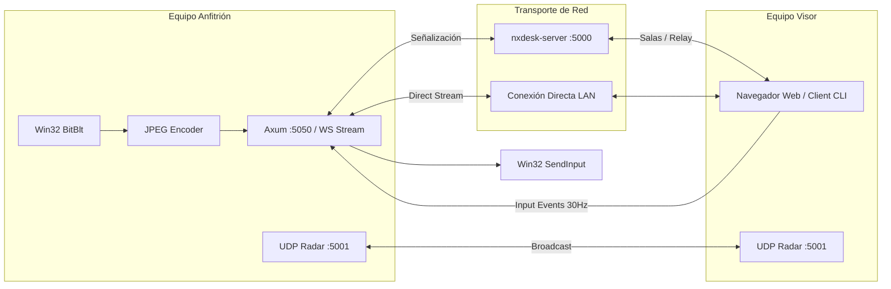

# 📘 Documentación Técnica Oficial — NxDesk

## 1. Descripción General
NxDesk es una plataforma de escritorio remoto, asistencia técnica y streaming de ultra-baja latencia que opera de forma autónoma sin depender de servidores centralizados en la nube. Resuelve la latencia elevada, la dependencia de servicios comerciales propietarios y la falta de control sobre la privacidad en redes locales y empresariales.

---

## 2. Tecnologías y Requisitos

### Tecnologías Principales
* **Rust (2021 Edition):** Motor nativo de streaming, Tokio 1.38, Axum 0.8.9 (Web Dashboard), Tokio-Tungstenite (WebSockets), Win32 GDI / SendInput.
* **C# (.NET 10.0):** Cliente de escritorio alternativo con Avalonia UI 11.3 (Fluent MVVM), SharpDX (DirectX 11 DXGI) y ASP.NET Core SignalR.
* **Protocolos:** WebSockets con delimitador SignalR `0x1E`, UDP Broadcast en puerto `5001`.

### Requisitos del Sistema
* **Windows 10 / 11 (64-bit)** o **Linux** (con PipeWire / X11).
* **Rust Toolchain:** `rustc` y `cargo` 1.75+ (`rustup default stable`).
* **.NET SDK:** Versión 10.0+ (solo para compilación del ecosistema C#).
* Red local Wi-Fi o Ethernet para streaming y radar de descubrimiento.

---

## 3. Instalación y Configuración

1. **Clonar el repositorio:**
   ```powershell
   git clone https://github.com/usuario/NxDesk.git
   cd NxDesk
   ```

2. **Compilar el ecosistema Rust (Cliente y Servidor):**
   ```powershell
   cd nxdesk-rust
   cargo build --release
   ```

3. **(Opcional) Compilar la solución .NET 10:**
   ```powershell
   cd ..
   dotnet build NxDesk.slnx
   ```

4. **Configurar regla de Firewall en Windows (PowerShell como Administrador):**
   ```powershell
   New-NetFirewallRule -DisplayName "NxDesk Ports" -Direction Inbound -LocalPort 5000,5001,5050 -Protocol TCP -Action Allow
   ```

---

## 4. Uso

### Caso 1: Compartir Pantalla con Web Dashboard (Modo Anfitrión)
Inicia la captura y el servidor web para acceso local o remoto:
```powershell
cargo run -p nxdesk-client -- --share --port 5050
```
Accede desde cualquier navegador en `http://localhost:5050` o `http://<IP-HOST>:5050`.

### Caso 2: Conectar como Visor por ID o IP Directa
* **Vía Web Dashboard:** Abre `http://localhost:5050`, escribe el ID (ej. `111-222-333`) o la IP directa en el buscador superior y presiona **⚡ Conectar**.
* **Vía Línea de Comandos (CLI):**
  ```powershell
  # Conexión por ID AnyDesk (requiere nxdesk-server activo):
  cargo run -p nxdesk-client -- --connect 111-222-333

  # Conexión directa por IP en red local (P2P sin servidor de señalización):
  cargo run -p nxdesk-client -- --connect 192.168.1.50:5050
  ```

### Caso 3: Iniciar Servidor de Señalización Dedicado
```powershell
cargo run -p nxdesk-server
```
Escucha en `ws://0.0.0.0:5000/signalinghub` para coordinar salas concurrentes.

---

## 5. Estructura del Proyecto

```text
NxDesk/
├── nxdesk-rust/                 # Ecosistema nativo en Rust puro de alto rendimiento
│   ├── apps/client/             # Nodo cliente con Axum Web Dashboard, captura y control
│   ├── apps/server/             # Servidor de señalización Tokio-Tungstenite (puerto 5000)
│   ├── crates/capture/          # Captura Win32 GDI BitBlt y enumeración multimonitor
│   ├── crates/core/             # DTOs y modelos de datos compartidos con serialización PascalCase
│   ├── crates/discovery/        # Radar LAN UDP broadcast en puerto 5001 con Socket2
│   ├── crates/file-transfer/    # Gestor de archivos por bloques con sandbox estricto
│   ├── crates/input/            # Inyección de ratón y teclado mediante Win32 SendInput
│   ├── crates/signaling/        # Cliente WebSocket compatible con delimitador SignalR 0x1E
│   └── crates/terminal/         # Sesión interactiva ConPTY con blindaje de seguridad VUL-01
├── src/                         # Ecosistema C# .NET 10 bajo Clean Architecture
│   ├── NxDesk.Core/             # Entidades de dominio (PeerIdentity, SignalingMessage)
│   ├── NxDesk.Application/      # Interfaces de servicios y DTOs tipados
│   ├── NxDesk.Infrastructure/   # Adaptadores DirectX 11, GStreamer, SendInput y Kestrel
│   ├── NxDesk.Client/           # Aplicación de escritorio Avalonia UI 11 Fluent Theme
│   └── NxDesk.Server/           # Web API SignalR dedicada con documentación Swagger
├── packaging/linux/             # Archivos de empaquetado y accesos de distribución
├── tests/                       # Pruebas de integración y recursos de verificación
└── dist/releases/               # Distribuciones binarias empaquetadas
```

---

## 6. Arquitectura y Flujo Principal



1. **Descubrimiento:** Los nodos emiten pulsos periódicos en `UDP :5001` anunciando su ID, IP y estado.
2. **Negociación:** Los clientes se unen a una sala compartida en `TCP :5000` o establecen conexión directa vía HTTP/WS en `TCP :5050`.
3. **Streaming:** El anfitrión captura la pantalla (individual o mosaico virtual multimonitor), comprime los fotogramas en JPEG y los transmite por WebSocket.
4. **Control:** El visor normaliza coordenadas `(0.0 a 1.0)` y envía eventos de ratón/teclado filtrados a 30 Hz hacia el inyector `SendInput`.

---

## 7. Variables de Entorno y Configuración

| Parámetro CLI | Variable / Config | Descripción | Valor por Defecto |
| :--- | :--- | :--- | :--- |
| `--id=<ID>` | `DEVICE_ID` | Identificador único del equipo en formato de 9 dígitos | `111-222-333` (auto-generado al conectar) |
| `--alias=<NAME>` | `COMPUTERNAME` | Nombre amigable visible en el radar local | Hostname del sistema operativo |
| `--port=<PORT>` | `WEB_PORT` | Puerto HTTP para el Web Dashboard interactivo | `5050` (auto-incrementa si está ocupado) |
| `--server=<URL>` | `SIGNALING_URL` | URL WebSocket del servidor de señalización | `ws://127.0.0.1:5000/signalinghub` |
| `--password=<P>` | `ACCESS_PASSWORD` | Contraseña requerida para autorizar control remoto | Ninguna (acceso libre) |
| `--allow-remote-terminal` | `ALLOW_TERMINAL` | Bandera de seguridad para habilitar la terminal remota | `false` (bloqueada por defecto - VUL-01) |
| `--fps=<FPS>` | `MAX_FPS` | Límite máximo de fotogramas por segundo capturados | `30` |
| `--quality=<Q>` | `JPEG_QUALITY` | Calidad de compresión JPEG (1 a 100) | `75` |
| `--shared-folder=<DIR>` | `SANDBOX_PATH` | Carpeta segura autorizada para transferencia de archivos | `~/Downloads/NxDeskShared` |

---

## 8. API y Endpoints Principales (Axum Web Server)

| Método | Endpoint | Parámetros (Body / Query) | Respuesta | Descripción |
| :--- | :--- | :--- | :--- | :--- |
| `GET` | `/api/status` | Ninguno | `StatusResponse` (JSON) | Retorna estado del nodo, espectadores web, usuarios en sala e ID. |
| `GET` | `/api/screens` | Ninguno | `Vec<ScreenInfoDto>` | Lista monitores físicos y opción Mosaico Doble Pantalla. |
| `POST` | `/api/screens/select` | `{ "index": 0 }` | `Result<ScreenInfoDto, String>` | Conmuta la captura activa a otro monitor sin reiniciar sesión. |
| `POST` | `/api/connect` | `{ "target": "111-222-333" }` | `{ "success": true, "message": "..." }` | Conecta el cliente a un equipo remoto por ID o dirección IP. |
| `POST` | `/api/disconnect` | Ninguno | `{ "success": true, "message": "..." }` | Finaliza la sesión remota y restablece la vista anfitrión local. |
| `POST` | `/api/terminal/auth` | `{ "enable": true, "password": "..." }` | `{ "success": true, "allowed": true }` | Desbloquea o bloquea en caliente la ejecución de la terminal remota (VUL-01). |
| `GET` | `/api/peers` | Ninguno | `Vec<PeerIdentity>` | Lista equipos descubiertos en LAN por el radar UDP 5001. |
| `GET` | `/api/files` | `?path=<DIR>` | `ListDirectoryResponse` | Lista archivos dentro del sandbox seguro de transferencias. |
| `POST` | `/api/input` | `InputEvent` (JSON) | `"OK"` | Inyecta eventos de ratón o teclado en el sistema anfitrión. |
| `WS` | `/ws/stream` | Protocolo WebSocket | Frames Binarios (JPEG) / JSON | Canal bidireccional de streaming de vídeo, input y terminal PTY. |

---

## 9. Pruebas y Contribución

### Ejecución de Pruebas Automatizadas
Para verificar la integridad de todos los módulos, serialización y validaciones de seguridad:
```powershell
# Batería completa de pruebas unitarias en Rust (23 tests aprobados)
cd nxdesk-rust
cargo test --all

# Verificación de compilación limpia de la solución C#
dotnet build --no-incremental
```

### Guía de Contribución
1. Haz un Fork del repositorio y crea una rama: `git checkout -b feature/nueva-mejora`.
2. Mantén la separación de capas de **Clean Architecture** (Dominio libre de dependencias).
3. Asegura **0 advertencias** y **0 errores** de compilación en `cargo check` y `dotnet build`.
4. Ejecuta `cargo test --all` antes de enviar cualquier Pull Request.

---

## 10. Despliegue en Producción y Operaciones SRE

### 10.1 Reverse Proxy TLS (Caddy y Nginx)
Para exponer el Web Dashboard y el Hub de Señalización en Internet pública (WAN) con cifrado SSL/TLS estricto (`https://` y `wss://`):

* **Caddy (Recomendado):** Utiliza [deploy/caddy/Caddyfile](file:///c:/Users/User/Downloads/nxDesk/NxDesk/NxDesk/deploy/caddy/Caddyfile). Caddy aprovisiona y renueva automáticamente certificados Let's Encrypt / ZeroSSL sin requerir configuración manual.
  ```bash
  caddy run --config deploy/caddy/Caddyfile
  ```
* **Nginx:** Emplea [deploy/nginx/nxdesk.conf](file:///c:/Users/User/Downloads/nxDesk/NxDesk/NxDesk/deploy/nginx/nxdesk.conf) con soporte para WebSocket Upgrade (`Upgrade $http_upgrade`, `Connection $connection_upgrade`) y buffers deshabilitados para garantizar 60 FPS sin buffering.

### 10.2 Gestión de Procesos Daemon (Alta Disponibilidad 24/7)
* **Linux (Systemd):**
  Unidad de servicio en [deploy/systemd/nxdesk-server.service](file:///c:/Users/User/Downloads/nxDesk/NxDesk/NxDesk/deploy/systemd/nxdesk-server.service).
  ```bash
  sudo cp deploy/systemd/nxdesk-server.service /etc/systemd/system/
  sudo systemctl daemon-reload
  sudo systemctl enable --now nxdesk-server.service
  ```
  Configurado con `Restart=always`, `RestartSec=5s`, descriptores `LimitNOFILE=65536` y políticas de aislamiento de kernel (`ProtectSystem=full`, `NoNewPrivileges=true`).

* **Windows (Servicio de Windows con NSSM):**
  Script automatizado en [deploy/windows/install-service-nssm.ps1](file:///c:/Users/User/Downloads/nxDesk/NxDesk/NxDesk/deploy/windows/install-service-nssm.ps1).
  ```powershell
  # Ejecutar en PowerShell como Administrador:
  .\deploy\windows\install-service-nssm.ps1 -Port 5000
  ```
  Registra el servicio con auto-recuperación ante caídas en menos de 5 segundos y rotación automática de logs en `logs/service-stdout.log` y `logs/service-stderr.log`.

### 10.3 Despliegue Contenerizado con Docker Compose
```bash
cd deploy/docker
docker compose up -d
```
Levanta simultáneamente el contenedor nativo de `nxdesk-server` junto con el proxy inverso Caddy configurado para HTTP/3 QUIC y TLS automático.

