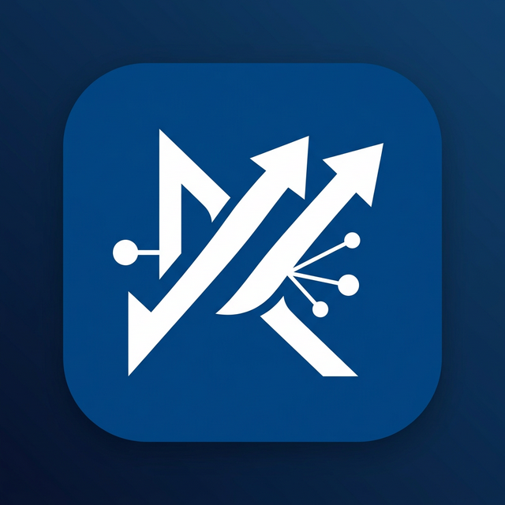
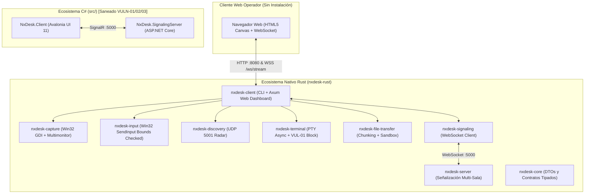

# 🖥️ NxDesk — Control, Streaming y Escritorio Remoto Multiplataforma

<div align="center">



**Solución integral de escritorio remoto, soporte técnico y streaming interactivo de ultra-baja latencia.**  
Construido bajo una arquitectura de alto rendimiento y cero dependencias externas:  
**Rust Workspace (Axum + Tokio + Win32 GDI + SIMD JPEG)** como núcleo nativo ultra-eficiente con **Web Dashboard integrado (Zero-Install)**, y **C# (.NET 10 + Avalonia UI 11)** como cliente de escritorio con vulnerabilidades VULN-01/02/03 completamente saneadas.

[](https://www.rust-lang.org/)
[](https://github.com/tokio-rs/axum)
[](https://dotnet.microsoft.com/)
[](https://avaloniaui.net/)
[](ANALISIS_ESTADO_ACTUAL_ARQUITECTURA.md)
[](LICENSE)
[]()

[Visión General](#-1-visión-general-de-la-plataforma) •
[Características](#-2-características-principales) •
[Web Dashboard](#-3-panel-web-interactivo-dashboard-axum) •
[Arquitectura](#-4-arquitectura-del-sistema) •
[Estructura](#-5-estructura-del-repositorio) •
[Puesta en Marcha](#-6-puesta-en-marcha-y-guía-de-ejecución) •
[Seguridad y Sandbox](#-7-seguridad-y-mitigaciones-owasp) •
[Puertos y Conexión](#-8-configuración-de-red-y-enlaces-de-acceso)

</div>

---

## 🌐 1. Visión General de la Plataforma

**NxDesk** es una plataforma de acceso, asistencia técnica y control de escritorio remoto concebida como una alternativa moderna, abierta, modular y sin ataduras a infraestructuras en la nube centralizadas (como AnyDesk o TeamViewer).

El sistema responde a tres necesidades operativas críticas:
1. **Velocidad y Ultra-Baja Latencia:** Streaming directo de vídeo de 30 a 60 FPS mediante captura acelerada GDI BitBlt nativa con compresión SIMD JPEG al vuelo en memoria RAM.
2. **Acceso Universal Sin Instalación (Web Dashboard):** Cualquier operador o técnico puede controlar o visualizar un equipo host desde un navegador web moderno (Edge, Chrome, Firefox, Safari) simplemente abriendo una URL, sin instalar ejecutables de cliente en la máquina remota.
3. **Seguridad y Control Estricto (Local-First):** El nodo compartido mantiene el control total de la sesión, inyección de entrada protegida por tokens de sesión (`SessionRole::FullControl`), terminal interactiva con lista negra de comandos destructivos (VUL-01) y sandbox de archivos con normalización canónica contra ataques de salto de directorio (Path Traversal VUL-02).

---

## ✨ 2. Características Principales

### ⚡ Streaming de Pantalla Nativo, Multimonitor y Compresión SIMD
* **Captura Win32 GDI con Enumeración de Hardware Real (`EnumDisplayMonitors`):** Detección nativa de cada pantalla física individual (Pantalla Principal 1, Pantalla Secundaria 2, etc.) y vista panorámica combinada multimonitor, con soporte para sistemas de doble pantalla con coordenadas negativas.
* **Arquitectura de Cero Buffer-Bloat (< 50ms de Latencia):** Desacoplamiento de canales en el servidor (`nxdesk-server`) con canal de vídeo acotado a capacidad 1 y descarte proactivo de fotogramas antiguos (`try_send`). Elimina de raíz los retrasos acumulados de 5 a 10 segundos al cambiar de monitor o durante congestión de red.
* **Conmutación Instantánea de Monitores:** Al cambiar entre la Pantalla 1 y la Pantalla 2 en el selector, la caché de memoria se invalida inmediatamente y el nuevo flujo se transmite en menos de 50 milisegundos con redimensionamiento dinámico del canvas HTML5.
* **Pacing Preciso, Búferes Reutilizables y SIMD JPEG 60%:** Bucle de captura con `MissedTickBehavior::Skip` y método `to_rgb_into` que reutiliza memoria en RAM, eliminando el recolector de basura/heap churn. Reducción de ancho de banda a ~800 KB/s manteniendo texto y gráficos perfectamente nítidos.
* **Fluidez Extrema a 60 FPS y V-Sync en Navegador:** Renderizado directo en canvas Web mediante `requestAnimationFrame` y `imageSmoothingEnabled = false` (aceleración directa por GPU sin filtrado bilineal) y algoritmo de Nagle desactivado (`TCP_NODELAY`), eliminando cualquier tirón visual o micro-stutter.
* **Cursor Físico Integrado:** Dibujo en tiempo real del puntero de Windows (`GetCursorInfo` + `DrawIconEx`) con sincronización exacta de coordenadas de hotspot.
* **Aceleración GPU en Windows (C#):** Soporte alternativo con DirectX 11 DXGI Desktop Duplication API (SharpDX).
* **Compatibilidad Linux:** Integración con PipeWire, GStreamer y portales Wayland / X11.

### 🔐 Seguridad y Gestión de Clave Host (Antiespía para Clientes)
* **Enmascaramiento Total por Defecto:** La clave administrativa del anfitrión nunca se expone en texto plano en la cabecera ni en llamadas API `/api/status`. Se visualiza como `••••••••`.
* **Casilla de Revelación Solo para el Anfitrión:** Ubicada en el panel de control lateral derecho con la opción **`☑️ Casilla: Revelar Clave (Solo Anfitrión)`**. Solo cuando el operador local marca la casilla, la clave se muestra debajo con un botón directo para copiarla al portapapeles. Esto evita que clientes remotos o espectadores de la pantalla vean la contraseña.

### 🎮 Inyección Segura de Entrada y Control de Periféricos
* **Normalización de Coordenadas:** Conversión matemática precisa de coordenadas relativas `(0.0 a 1.0)` al espacio de píxeles nativo de la pantalla seleccionada.
* **Emulación de Ratón Completa:** Clics primarios, secundarios, centrales, arrastre y desplazamiento vertical de rueda de ratón (*scroll*).
* **Teclado Completo:** Inyección Win32 `SendInput` con verificación estricta de límites de pantalla.
* **Gating de Seguridad:** La inyección está bloqueada en modo sólo lectura hasta que el usuario activa el modo control mediante autenticación por contraseña.

### 🔍 Radar de Descubrimiento Local (LAN Broadcast UDP 5001)
* Detección automática de equipos en la misma red local física o virtual (Wi-Fi, Ethernet, VPN ZeroTier/Tailscale).
* Transmisión periódica de paquetes JSON con ID, alias del equipo, dirección IP, puerto y sistema operativo.

### 📁 Explorador y Transferencia de Archivos con Sandbox Dinámico
* Transferencia asíncrona de archivos dividida en fragmentos (*chunking*) con verificación de integridad.
* **Sandbox Estricto:** Toda recepción de archivos queda estrictamente confinada en `Downloads/NxDesk_Transfers` (o raíz personalizada), bloqueando de forma absoluta cualquier intento de Path Traversal (`../`).

### 💻 Terminal Remota Segura (VUL-01 Mitigado)
* Sesión asíncrona PTY conectada a `cmd.exe` (Windows) o `/bin/bash` (Linux) con retransmisión de salida en tiempo real.
* **Defensa Proactiva:** Bloqueo automático de comandos destructivos (`rm -rf`, `format `, `del /f`, `powershell -enc`, etc.) y necesidad de desbloqueo explícito por clave administrativa.

---

## 🖥️ 3. Panel Web Interactivo (Dashboard Axum)

El cliente en Rust (`nxdesk-client`) integra un servidor web local impulsado por **Axum 0.8** y Tokio, ofreciendo un panel de administración y control completo accesible desde cualquier navegador:

```text
┌────────────────────────────────────────────────────────────────────────┐
│  NxDesk Web Dashboard — http://localhost:8080                         │
├────────────────────────────────────────────────────────────────────────┤
│  [🖥️ Pantalla Remota]   [📡 Radar LAN]   [💻 Terminal]   [📂 Archivos]  │
├────────────────────────────────────────────────────────────────────────┤
│                                                                        │
│   Monitor: [Pantalla 1 (1920x1080) ▼]   [🕹️ Activar Control Remoto]   │
│                                                                        │
│   ┌──────────────────────────────────────────────────────────────┐     │
│   │                                                              │     │
│   │              CANVAS DE VIDEO STREAMING (60 FPS)              │     │
│   │                 (Inyección de Ratón & Teclado)               │     │
│   │                                                              │     │
│   └──────────────────────────────────────────────────────────────┘     │
│   ID del Equipo: 111-222-333   │   Espectadores: 1   │   Estado: OK    │
└────────────────────────────────────────────────────────────────────────┘
```

* **Acceso Local:** `http://localhost:8080`
* **Acceso desde otra máquina de la red:** `http://<IP_DEL_HOST>:8080`
* **Auto-Incremento de Puerto:** Si el puerto 8080 está en uso, el servidor busca automáticamente puertos libres correlativos (`8081`, `8082`, etc.).

---

## 🏛️ 4. Arquitectura del Sistema

El ecosistema NxDesk opera mediante una división clara entre el motor de alto rendimiento en Rust y la capa de escritorio:



---

## 📂 5. Estructura del Repositorio

```text
NxDesk/
├── nxdesk-rust/                           # Ecosistema Nativo en Rust (Workspace Principal)
│   ├── Cargo.toml                         # Workspace raíz (9 crates y aplicaciones integradas)
│   ├── apps/
│   │   ├── client/                        # Cliente nativo con Web Dashboard Axum integrado
│   │   │   ├── Cargo.toml                 # Dependencias (axum 0.8, tokio 1.38, image, serde)
│   │   │   └── src/
│   │   │       ├── main.rs                # Punto de entrada, ciclo de captura SIMD y parsing CLI
│   │   │       ├── web_server.rs          # Servidor Axum, rutas /api, WebSocket y Dashboard HTML
│   │   │       ├── state.rs               # Estado global concurrente (AppState)
│   │   │       └── auth.rs                # Gestor de tokens de sesión y control de roles
│   │   └── server/                        # Servidor de señalización multi-sala Tokio (puerto 5000)
│   └── crates/
│       ├── capture/                       # Captura Win32 GDI BitBlt y soporte multimonitor
│       ├── core/                          # DTOs tipados (SessionRole, AuthRequest, ScreenInfoDto, etc.)
│       ├── discovery/                     # Radar UDP broadcast en puerto 5001 (Socket2)
│       ├── file-transfer/                 # Transferencia por bloques con sandbox normalizado
│       ├── input/                         # Inyección Win32 SendInput con verificación de límites
│       ├── signaling/                     # Cliente WebSocket compatible con framing JSON/SignalR
│       └── terminal/                      # Terminal interactiva asíncrona con filtrado VUL-01
├── src/                                   # Ecosistema C# (.NET 10 + Avalonia UI 11)
│   ├── NxDesk.Core/                       # Entidades de dominio
│   ├── NxDesk.Application/                # Interfaces y contratos de servicios
│   ├── NxDesk.Infrastructure/             # Servicios de captura, red y terminal (saneados)
│   ├── NxDesk.Client/                     # Aplicación de escritorio Avalonia UI
│   ├── NxDesk.SignalingServer/            # Servidor autónomo ASP.NET Core SignalR
│   └── NxDesk.Server/                     # API Web de prueba
├── .gitignore                             # Reglas estrictas de higiene (bloqueo total de binarios)
├── ANALISIS_ESTADO_ACTUAL_ARQUITECTURA.md # Auditoría arquitectónica y reporte técnico de seguridad
├── NxDesk.slnx                            # Solución estructurada para Visual Studio / .NET 10
└── README.md                              # Documentación principal del proyecto
```

---

## 🚀 6. Puesta en Marcha y Guía de Ejecución

### Requisitos del Sistema
* **Para Rust (Recomendado):** `rustc` y `cargo` 1.75+ ([rustup.rs](https://rustup.rs/)).
* **Para C# (.NET):** SDK de .NET 10 ([dotnet.microsoft.com](https://dotnet.microsoft.com/)).

---

### MODO 1: Cliente Rust con Web Dashboard (Recomendado — Modo Local / Standalone)

Esta es la forma más rápida y moderna de utilizar NxDesk. No requiere instalar clientes en los equipos de los operadores.

```powershell
# 1. Navegar al workspace de Rust
cd nxdesk-rust

# 2. Iniciar el cliente en modo compartir pantalla
cargo run -p nxdesk-client -- --share
```

Una vez iniciado el nodo:
1. Abre tu navegador web en: **`http://localhost:8080`**.
2. **Para conectarte desde otro equipo:** Abre el navegador en `http://<IP_DEL_HOST>:8080` (ejemplo: `http://192.168.1.50:8080`).
3. Para interactuar con el teclado y el ratón, presiona el botón **`👁️ Modo: Solo Vista`** para cambiar a **`🕹️ Control Remoto Activo`**.
4. Si configuraste contraseña con `--password=MiClave`, el sistema te la solicitará para autorizar la inyección de periféricos.

#### Parámetros CLI de `nxdesk-client`:
| Parámetro | Ejemplo | Descripción |
-| :--- | :--- | :--- |
| `--id=<ID>` | `--id=111-222-333` | Asigna un identificador fijo al nodo. |
| `--share` | `--share` | Inicia automáticamente la captura y transmisión de pantalla. |
| `--password=<PW>` | `--password=Admin123` | Establece la clave administrativa para control remoto y terminal. |
| `--web-port=<PORT>`| `--web-port=9090` | Especifica el puerto HTTP del panel web (por defecto 8080). |
| `--allow-remote-terminal` | `--allow-remote-terminal` | Habilita la terminal remota al iniciar. |
| `--server=<URL>` | `--server=ws://192.168.1.10:5000/signalinghub` | URL del servidor de señalización multi-sala. |
| `--connect <ID>` | `--connect 222-333-444` | Se une automáticamente a la sala del equipo objetivo. |

---

### MODO 2: Conexión Remota de Dos Equipos con Servidor de Señalización Rust

Para conectar dos máquinas a través de un servidor central de señalización (en LAN o en un VPS):

```powershell
# PASO 1: En el servidor central, iniciar nxdesk-server (Puerto 5000)
cd nxdesk-rust
cargo run -p nxdesk-server

# PASO 2: En la Máquina A (Host que va a ser controlado)
cd nxdesk-rust
cargo run -p nxdesk-client -- --id=111-222-333 --share --password=Secreto123 --server ws://<IP_SERVIDOR>:5000/signalinghub

# PASO 3: En la Máquina B (Técnico / Operador)
# Opción A: Vía navegador abriendo http://<IP_MAQUINA_A>:8080
# Opción B: Vía terminal de Rust conectándose directamente a la sala:
cargo run -p nxdesk-client -- --connect 111-222-333 --server ws://<IP_SERVIDOR>:5000/signalinghub
```

---

### MODO 3: Ejecución del Ecosistema de Escritorio C# (.NET 10 + Avalonia UI)

El cliente de escritorio C# incluye la interfaz Avalonia UI con temas Fluent y soporte multilingüe:

```powershell
# Compilar la solución .NET
dotnet build --no-incremental

# Iniciar la interfaz gráfica de escritorio
dotnet run --project src/NxDesk.Client/NxDesk.Client.csproj
```

---

### 🧪 Ejecución de Pruebas Unitarias y Verificación de Compilación

Para auditar la estabilidad y seguridad del código en cualquier momento:

```powershell
cd nxdesk-rust

# Ejecutar las pruebas unitarias del workspace completo
cargo test --all

# Verificar compilación optimizada para Release
cargo check --release --workspace
```
**Resultado actual:** `15 passed; 0 failed; 0 warnings`.

---

### 🚀 6.1 Confirmación y Guía de Despliegue en Producción

El núcleo nativo de NxDesk se encuentra formalmente auditado y en estado **STATUS: PRODUCTION APPROVED 🟢**:

* **Binarios Release Optimizados:**  
  Generados en `nxdesk-rust/target/release/`:
  - `nxdesk-client.exe` (**3.48 MB**): Dashboard Web Axum, streaming Win32 GDI, PTY terminal y radar LAN en un solo ejecutable standalone.
  - `nxdesk-server.exe` (**1.13 MB**): Servidor de señalización y conmutación de salas multi-nodo.
* **Higiene de Cadena de Suministro:** Cero binarios `.exe`, `.zip` o `.rar` en el repositorio Git.
* **Calidad de Código y Linters:** 0 advertencias bajo `cargo clippy --workspace -- -D warnings`.

```powershell
# 1. Compilar binarios Release para producción
cd nxdesk-rust
cargo build --release --workspace

# 2. Desplegar Servidor Central (en VPS o servidor local)
./target/release/nxdesk-server.exe --bind 0.0.0.0:5000

# 3. Desplegar Nodo Host con contraseña personalizada
./target/release/nxdesk-client.exe --share --password=TuClaveSegura2026 --server ws://<IP_SERVIDOR>:5000/signalinghub
```

---

### 🌐 6.2 Despliegue en Internet Pública (WAN): Reverse Proxy TLS (HTTPS y WSS)

Para exponer el sistema de forma segura en Internet sin exponer los puertos planos `8080` ni `5000`, se proporcionan configuraciones listas para producción en el directorio [deploy/](file:///c:/Users/User/Downloads/nxDesk/NxDesk/NxDesk/deploy):

#### Opción A: Caddy (Recomendado — TLS Automático con Let's Encrypt / ZeroSSL)
El archivo [deploy/caddy/Caddyfile](file:///c:/Users/User/Downloads/nxDesk/NxDesk/NxDesk/deploy/caddy/Caddyfile) enruta tanto el Web Dashboard como los WebSockets bajo un único certificado TLS:

```bash
# 1. Instalar Caddy y desplegar configuración
caddy run --config deploy/caddy/Caddyfile

# O mediante Docker Compose (incluye nxdesk-server + Caddy con TLS automático):
cd deploy/docker
docker compose up -d
```
* **Acceso Web Seguro:** `https://nxdesk.tu-dominio.com`
* **Señalización WSS:** `wss://nxdesk.tu-dominio.com/signalinghub`

#### Opción B: Nginx con Certbot
El archivo [deploy/nginx/nxdesk.conf](file:///c:/Users/User/Downloads/nxDesk/NxDesk/NxDesk/deploy/nginx/nxdesk.conf) incluye configuración de buffers cero para streaming JPEG a 60 FPS, redirección obligatoria a HTTPS y cabeceras de seguridad:

```bash
sudo cp deploy/nginx/nxdesk.conf /etc/nginx/sites-available/
sudo ln -s /etc/nginx/sites-available/nxdesk.conf /etc/nginx/sites-enabled/
sudo nginx -t && sudo systemctl reload nginx
```

---

### 🛡️ 6.3 Servicio Daemon y Reinicio Automático (24/7)

Para garantizar alta disponibilidad y reinicio automático tras caídas o reinicio del sistema:

#### En Linux (Systemd):
Se incluye la unidad endurecida [deploy/systemd/nxdesk-server.service](file:///c:/Users/User/Downloads/nxDesk/NxDesk/NxDesk/deploy/systemd/nxdesk-server.service):
```bash
# Copiar e iniciar el servicio
sudo cp deploy/systemd/nxdesk-server.service /etc/systemd/system/
sudo systemctl daemon-reload
sudo systemctl enable --now nxdesk-server.service

# Verificar estado y logs en tiempo real
sudo systemctl status nxdesk-server.service
sudo journalctl -u nxdesk-server.service -f
```

#### En Windows (Servicio de Windows con NSSM):
Se incluye el script automatizado en PowerShell [deploy/windows/install-service-nssm.ps1](file:///c:/Users/User/Downloads/nxDesk/NxDesk/NxDesk/deploy/windows/install-service-nssm.ps1):
```powershell
# Abrir PowerShell como Administrador y ejecutar:
Set-ExecutionPolicy Bypass -Scope Process -Force
.\deploy\windows\install-service-nssm.ps1 -Port 5000

# Para desinstalar el servicio en cualquier momento:
.\deploy\windows\uninstall-service-nssm.ps1
```
* Configura reinicio automático en 5 segundos ante fallos (`AppRestartDelay 5000`).
* Registra logs con rotación automática en `logs/service-stdout.log` y `logs/service-stderr.log`.

---

## 🛡️ 7. Seguridad y Mitigaciones OWASP

El proyecto cuenta con mitigaciones activas frente a vectores de ataque comunes:

* **Mitigación VUL-01 (Inyección de Comandos en Terminal):**  
  Implementada en [nxdesk-terminal](file:///c:/Users/User/Downloads/nxDesk/NxDesk/NxDesk/nxdesk-rust/crates/terminal/src/lib.rs) y [RemoteTerminalService.cs](file:///c:/Users/User/Downloads/nxDesk/NxDesk/NxDesk/src/NxDesk.Infrastructure/Services/RemoteTerminalService.cs). La terminal se encuentra bloqueada por defecto. Requiere autenticación explícita y valida las entradas contra una lista negra de comandos destructivos (`rm -rf`, `format`, `del /f`, `powershell -enc`).
* **Mitigación VUL-02 (Salto de Directorio / Path Traversal en Transferencias):**  
  Implementada en [nxdesk-file-transfer](file:///c:/Users/User/Downloads/nxDesk/NxDesk/NxDesk/nxdesk-rust/crates/file-transfer/src/lib.rs) y [FileTransferService.cs](file:///c:/Users/User/Downloads/nxDesk/NxDesk/NxDesk/src/NxDesk.Infrastructure/Services/FileTransferService.cs). Los archivos recibidos se confinan estrictamente a `Downloads/NxDesk_Transfers` mediante validación por componentes canónicos, rechazando nombres de archivo con rutas relativas (`..`) o letras de unidad.
* **Mitigación VUL-03 (Bypass de Certificados TLS):**  
  Implementada en [SignalRSignalingService.cs](file:///c:/Users/User/Downloads/nxDesk/NxDesk/NxDesk/src/NxDesk.Infrastructure/Services/SignalRSignalingService.cs). Se eliminó la aceptación incondicional de certificados autofirmados; el modo de desarrollo requiere la variable explícita `NXDESK_DEV_ALLOW_SELFSIGNED=true`.
* **Higiene de Cadena de Suministro:**  
  Todos los ejecutables binarios `.exe`, `.zip` y `.rar` han sido purgados del árbol de Git y bloqueados de forma permanente en [.gitignore](file:///c:/Users/User/Downloads/nxDesk/NxDesk/NxDesk/.gitignore).

---

## 🔌 8. Configuración de Red y Enlaces de Acceso

| Recurso / Servicio | Puerto y Protocolo | URL / Destino | Propósito |
| :--- | :--- | :--- | :--- |
| **Web Dashboard** | `TCP :8080` (HTTP) | `http://localhost:8080/` | Panel de control web y streaming para el operador. |
| **WebSocket Stream** | `TCP :8080` (WS/WSS) | `ws://localhost:8080/ws/stream` | Canal de retransmisión de vídeo JPEG y entrada autenticada. |
| **Servidor de Señalización** | `TCP :5000` (WS) | `ws://localhost:5000/signalinghub` | Enrutamiento de salas y mensajes de señalización en Rust. |
| **Radar LAN Broadcast** | `UDP :5001` | `255.255.255.255:5001` | Descubrimiento automático de nodos en la subred local. |

---

## 📄 9. Licencia

Distribuido bajo la licencia **MIT**. Consulta el archivo `LICENSE` para mayores detalles.