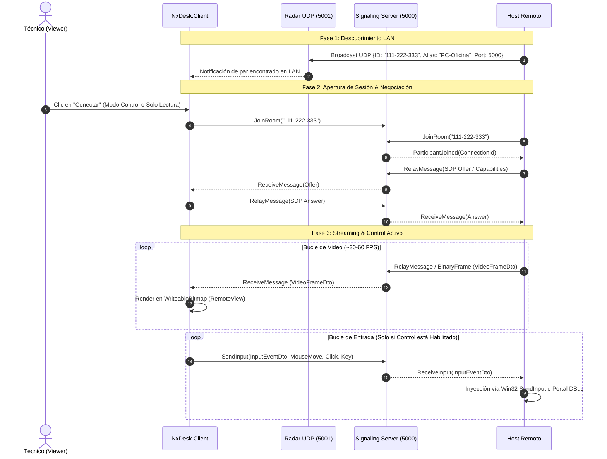

# 🖥️ NxDesk — Control, Streaming y Escritorio Remoto Multiplataforma

<div align="center">


**Solución integral de escritorio remoto, asistencia técnica y streaming de baja latencia.**  
Construido bajo un diseño de doble arquitectura de alto rendimiento: 
**C# (.NET 10 + Avalonia UI 11)** para una experiencia gráfica moderna y rica, y **Rust (Tokio + Tungstenite)** para un núcleo de ultra-bajo consumo y velocidad nativa.

[](https://dotnet.microsoft.com/)
[](https://avaloniaui.net/)
[](https://www.rust-lang.org/)
[](LICENSE)
[](#-compatibilidad-multiplataforma)
[]()

[Visión General](#-visión-general) •
[Características](#-características-principales) •
[Arquitectura](#-arquitectura-del-sistema) •
[Estructura](#-estructura-del-repositorio) •
[Puesta en Marcha](#-puesta-en-marcha) •
[Puertos y Conexión](#-configuración-de-red-y-enlaces-de-acceso) •
[Centro de Documentación](#-centro-de-documentación-y-referencias) •
[Tecnologías](#-stack-tecnológico)

</div>

---

## 🌐 1. Visión General de la Plataforma

**NxDesk** es una plataforma de acceso, soporte y control de escritorio remoto concebida como una alternativa moderna, modular, de código abierto y sin ataduras a servidores propietarios centralizados (como AnyDesk o TeamViewer). 

El sistema resuelve los tres desafíos primordiales del trabajo y soporte remoto contemporáneo:
1. **Velocidad y Ultra-Baja Latencia:** Streaming directo de vídeo optimizado para aceleración por hardware o canalización directa de búferes de pantalla con baja sobrecarga de serialización.
2. **Independencia y Flexibilidad de Red (Modelo Standalone / LAN First):** Puede operar sin servidores externos en la nube gracias a su radar de descubrimiento UDP Broadcast local y su servidor de señalización Kestrel embebido dentro del propio cliente.
3. **Control y Supervisión Transparente:** La máquina compartida (host) mantiene en todo momento el control de la sesión mediante un widget flotante informativo que permite cortar la transmisión inmediatamente, junto con modos diferenciados de *Sólo Lectura* y *Control Total* respaldados por protección de clave de administrador.

### Los Dos Ecosistemas del Proyecto
* **C# (.NET 10 + Avalonia UI):** Es el cliente principal de producción con interfaz de usuario avanzada, soporte para temas (Dark/Light), internacionalización completa (Español / Inglés), grabación de sesiones, terminal integrada y explorador remoto de archivos.
* **Rust (`nxdesk-rust/`):** Implementación paralela de alto rendimiento construida con Tokio, WebSockets asíncronos y llamadas nativas Win32 GDI / SendInput. Diseñada para dispositivos embebidos, servidores sin interfaz gráfica (*headless*) o entornos con limitaciones severas de memoria.

---

## ✨ 2.Características Principales

### ⚡ Streaming de Pantalla de Alta Eficiencia
* **Aceleración GPU en Windows:** Captura mediante la **DXGI Desktop Duplication API** de DirectX 11 (SharpDX), accediendo directamente a la memoria de la tarjeta gráfica sin pasar por la CPU.
* **Soporte Nativo Linux:** Integración con **GStreamer**, **PipeWire** y los portales D-Bus de FreeDesktop (`org.freedesktop.portal.ScreenCast`), garantizando compatibilidad tanto en entornos modernos **Wayland** (GNOME / KDE) como en servidores **X11**.
* **Motor Nativo en Rust:** Captura instantánea de búfer de pantalla mediante Win32 GDI `BitBlt` optimizado con reuso de mapa de bits.

### 🎮 Inyección Nativa de Entrada y Control Remoto
* **Precisión Absoluta:** Conversión de coordenadas de ratón normalizadas `(0.0 a 1.0)` al espacio virtual de escritorio de la máquina de destino (incluyendo configuraciones multimonitor).
* **Manejo Completo de Ratón:** Detección y réplica de botón izquierdo, derecho, central y rueda de desplazamiento (*mouse wheel* vertical y horizontal).
* **Teclado:** Emulación de eventos `KeyDown` y `KeyUp` mapeando códigos virtuales (`VK_*`) y secuencias de control.
* **Doble Modo de Sesión:**
  * 👁️ **Solo Lectura (*View-Only*):** Permite visualizar la pantalla sin que los clics o pulsaciones afecten a la máquina host (ideal para presentaciones o auditorías).
  * 🕹️ **Control Total (*View with Control*):** Habilita la inyección de teclado y ratón, restringido por defecto tras clave de administrador.

### 📡 Servidor de Señalización Híbrido (Embebido y Autónomo)
* **Modo Autónomo (*Standalone / In-Process*):** El cliente NxDesk inicia automáticamente en segundo plano un servidor Kestrel SignalR en el puerto `5000` (con búsqueda incremental hasta `5099` en caso de conflicto). No es obligatorio levantar un servidor externo para trabajar en red local.
* **Servidor Central Dedicado:** Se incluyen implementaciones de servidor dedicado tanto en ASP.NET Core (`NxDesk.SignalingServer`) como en Rust Tokio (`nxdesk-server`), capaces de gestionar salas concurrentes, retransmisión de ofertas/respuestas SDP y seguimiento de presencia con `PeerTracker`.

### 🔍 Radar de Descubrimiento Local (LAN Broadcast UDP)
* Detección instantánea de otros equipos en la misma subred física o virtual mediante paquetes UDP Broadcast en el puerto **`5001`**.
* Difusión automática de presencia cada 3 segundos compartiendo: identificador único, alias del equipo, dirección IP, puerto de señalización, estado (`Background` o `Connected`) y sistema operativo.

### 📁 Explorador y Transferencia de Archivos / Carpetas
* **Explorador Remoto Integrado:** Navegación por la estructura de discos y carpetas de la máquina remota en tiempo real mediante diálogos modales en Avalonia.
* **Transferencia por Bloques (*Chunking*):** Envío asíncrono y resiliente de archivos y carpetas completas divididas en fragmentos binarios con seguimiento de progreso.

### 💻 Terminal Remota Interactiva
* Consola interactiva integrada en panel lateral desplegable dentro de la sesión remota.
* Ejecuta nativamente `cmd.exe` o `PowerShell` en Windows y `/bin/bash` o `/usr/bin/script` en Linux, retransmitiendo entrada/salida y códigos de escape ANSI / VT100 en tiempo real.

### 🎥 Grabación de Sesiones en H.264 MP4
* Motor de grabación integrado que canaliza directamente los fotogramas JPEG o BGRA crudos hacia un proceso subordinado de **FFmpeg** utilizando el códec `libx264` con perfil rápido y empaquetado `MP4` optimizado para reproducción inmediata (`+faststart`).

### 🖥️ Gestión Multi-Monitor
* Detección física y lógica de pantallas conectadas al anfitrión remoto (`ScreenInfoDto`).
* Menú desplegable en cabecera para conmutar entre monitores en caliente sin reiniciar la sesión.

### 🛡️ Seguridad, Bloqueo y Modo Administrador
* **Modo Administrador Protegido:** Solicitud de contraseña para habilitar funciones críticas (control remoto, bloqueo de pantalla y transferencia de archivos).
* **Bloqueo Remoto de Pantalla:** Capacidad de activar una cortina de privacidad en el anfitrión mientras el técnico realiza labores administrativas.
* **Widget Flotante de Desconexión (*Host Disconnect Widget*):** Ventana siempre visible en el anfitrión con indicador lumínico parpadeante "LIVE", duración de la sesión y botón de expulsión inmediata del cliente remoto.

### 🎨 Experiencia Visual y Métricas de Rendimiento
* Diseñado con **Avalonia UI 11 Fluent Theme**, efectos de elevación (*box-shadows*), bordes redondeados y microinteracciones fluidas.
* Conmutador de tema **Oscuro (Dark)** y **Claro (Light)**.
* Soporte multiidioma dinámico (**Español** e **Inglés**).
* Telemetría en vivo: visualización continua de **FPS**, **latencia de red** con indicador semafórico (verde, amarillo, rojo) y duración de la conexión.

---

## 🏛️ 3. Arquitectura del Sistema

El ecosistema NxDesk implementa principios de **Clean Architecture** (Arquitectura Limpia) y separación estricta de responsabilidades:

```text
               ┌────────────────────────────────────────────────────────┐
               │            PRESENTACIÓN / UI / SERVIDORES              │
               │  NxDesk.Client (Avalonia)  │  NxDesk.SignalingServer   │
               └───────────┬───────────────────────────┬────────────────┘
                           │                           │
                           ▼                           ▼
               ┌────────────────────────────────────────────────────────┐
               │             CAPA DE APLICACIÓN (APPLICATION)           │
               │  Interfaces de Servicios (IScreenCapture, ISignaling)  │
               │  DTOs Tipados (VideoFrame, InputEvent, FileTransfer)  │
               └───────────┬───────────────────────────┬────────────────┘
                           │                           │
                           ▼                           ▼
               ┌────────────────────────────────────────────────────────┐
               │           CAPA DE INFRAESTRUCTURA (INFRASTRUCTURE)     │
               │  DesktopDuplication (DXGI) │ GStreamer PipeWire Linux  │
               │  Windows SendInput Win32   │ Linux Portal DBus Helper  │
               │  DiscoveryService UDP:5001 │ SignalR Client / Embedded │
               │  ScreenRecorder (FFmpeg)   │ RemoteTerminal (CMD/Bash) │
               └───────────┬───────────────────────────┬────────────────┘
                           │                           │
                           ▼                           ▼
               ┌────────────────────────────────────────────────────────┐
               │                 NÚCLEO / DOMINIO (CORE)                │
               │  PeerIdentity, SignalingMessage, PeerStatus (Inmutable)│
               └────────────────────────────────────────────────────────┘
```

### Flujo de Datos y Señalización


---

## 📂 4. Estructura del Repositorio

```text
NxDesk/
rendimiento en Rust
│   ├── Cargo.toml                         # Workspace con 5 crates y 2 aplicaciones
│   ├── apps/
│   │   ├── client/                        # Cliente CLI/headless de captura y conexión
│   │   └── server/                        # Servidor de señalización Tokio-Tungstenite (puerto 5000)
│   └── crates/
│       ├── capture/                       # Captura de pantalla Win32 GDI / BitBlt
│       ├── core/                          # Entidades y DTOs compatibles con el protocolo de C#
│       ├── discovery/                     # Radar UDP broadcast en puerto 5001 con Socket2
│       ├── input/                         # Inyección Win32 SendInput (pantalla virtual multimonitor)
│       └── signaling/                     # Cliente WebSocket compatible con delimitador SignalR 0x1E
├── src/                                   # Solución principal en C# (.NET 10)
│   ├── NxDesk.Core/                       # Capa de Dominio pura (PeerIdentity, PeerStatus, SignalingMessage)
│   ├── NxDesk.Application/                # Interfaces y DTOs tipados (IScreenCaptureService, InputEventDto, etc.)
│   ├── NxDesk.Infrastructure/             # Implementaciones concretas de hardware, red y sistema operativo
│   │   ├── Helpers/                       # Clases de soporte y converters
│   │   ├── Services/
│   │   │   ├── DesktopDuplicationCaptureService.cs  # Captura DirectX 11 DXGI (Windows)
│   │   │   ├── GstreamerCaptureService.cs           # Captura PipeWire / Wayland / GStreamer (Linux)
│   │   │   ├── X11CaptureService.cs                 # Captura legacy X11 (Linux)
│   │   │   ├── WindowsInputInjectionService.cs      # Inyección Win32 SendInput
│   │   │   ├── LinuxInputInjectionService.cs        # Inyección Wayland RemoteDesktop portal
│   │   │   ├── DiscoveryService.cs                  # Radar UDP Broadcast (puerto 5001)
│   │   │   ├── EmbeddedSignalingServer.cs           # Servidor Kestrel SignalR in-process
│   │   │   ├── SignalRSignalingService.cs           # Cliente SignalR WebSocket con reconexión
│   │   │   ├── RemoteTerminalService.cs             # Emulación de consola (cmd.exe / bash)
│   │   │   ├── FileTransferService.cs               # Streaming de archivos por bloques
│   │   │   ├── ScreenRecordingService.cs            # Tubería a proceso externo FFmpeg H.264
│   │   │   ├── ConfigurationService.cs              # Persistencia JSON en AppData
│   │   │   └── portal_helper.py / uinput_helper.py  # Helpers de D-Bus y uinput en Linux
│   ├── NxDesk.Client/                     # Aplicación GUI de escritorio (Avalonia UI 11)
│   │   ├── Assets/                        # Iconos, fuentes y diccionarios de idiomas (en-US, es-ES)
│   │   ├── Controls/                      # Controles reutilizables (Toast, Spinner, Terminal, ConnectionType)
│   │   ├── Styles/                        # Temas Fluent (Dark.axaml, Light.axaml, Styles.axaml)
│   │   ├── ViewModels/                    # ViewModels MVVM (MainWindowViewModel, SettingsViewModel)
│   │   └── Views/                         # Vistas XAML (MainWindow, HomeView, RemoteView, HostDisconnectWindow)
│   ├── NxDesk.SignalingServer/            # Servidor autónomo ASP.NET Core SignalR con PeerTracker
│   └── NxDesk.Server/                     # Servidor Web API alternativo con Swagger
├── tools/                                 # Herramientas auxiliares y scripts de sincronización
│   └── bridge/
│       └── sync-graph-to-archify.mjs      # Sincronizador de Grafo AST GitNexus & Archify
├── ANALISIS_ESTADO_ACTUAL_ARQUITECTURA.md # Auditoría técnica exhaustiva y estado arquitectónico
├── NxDesk.slnx                            # Archivo de solución XML moderno para .NET 10
└── README.md                              # Documento de cabecera del proyecto
```

---

## 🚀 5. Puesta en Marcha

### 1. Requisitos Previos

#### Para el Ecosistema C# (.NET 10)
* **SDK de .NET 10:** Descargar e instalar desde [.NET Downloads](https://dotnet.microsoft.com/download/dotnet/10.0) (comprobar con `dotnet --version`).
* **FFmpeg en PATH (Opcional, para grabación de vídeo):** Asegúrate de tener `ffmpeg` accesible en tu terminal si deseas utilizar la funcionalidad de grabación de sesiones.
* **Linux (Si se ejecuta en distribuciones Linux):**
  * `gstreamer1.0-tools`, `gstreamer1.0-plugins-base`, `gstreamer1.0-plugins-good`, `gstreamer1.0-pipewire`.
  * `python3`, `python3-pip`, `python3-pydbus` o `python3-dbus` para el portal Wayland.

#### Para el Ecosistema Rust (`nxdesk-rust/`)
* **Rust Toolchain:** Instalador `rustup` con cargo y rustc 1.75+ ([rustup.rs](https://rustup.rs/)):
  ```powershell
  winget install --id Rustlang.Rustup -e
  ```

---

### 2. Formas de Levantar el Proyecto

#### Modo 1: Cliente de Escritorio .NET 10 (Recomendado — Modo Standalone)
El cliente .NET incluye su propio servidor de señalización Kestrel embebido. Al iniciarse, levanta el puerto `5000` y el radar UDP `5001` sin requerir ningún paso adicional:

```bash
# Compilar la solución completa
dotnet build

# Iniciar la aplicación de escritorio
dotnet run --project src/NxDesk.Client/NxDesk.Client.csproj
```

#### Parámetros CLI del Cliente .NET:
Puedes iniciar clientes configurados por comandos para automatización o atajos de escritorio:
```bash
# Asignar un ID personalizado al iniciar
dotnet run --project src/NxDesk.Client -- --id=111-222-333

# Entrar directamente en modo transmisión / anfitrión
dotnet run --project src/NxDesk.Client -- --share

# Conectarse automáticamente a un ID remoto específico
dotnet run --project src/NxDesk.Client -- --connect 111-222-333
```

---

#### Modo 2: Servidor Central de Señalización Dedicado (.NET 10)
Si deseas desplegar un servidor de señalización centralizado en un servidor dedicado o máquina virtual:
```bash
dotnet run --project src/NxDesk.SignalingServer/NxDesk.SignalingServer.csproj
```
El servidor quedará a la escucha en `http://0.0.0.0:5000` con el endpoint de SignalR en `/signalinghub`.

---

#### Modo 3: Servidor de Señalización en Rust (`nxdesk-server`)
Para un servidor ultra-ligero de señalización con consumo mínimo de RAM:
```bash
cd nxdesk-rust
cargo run -p nxdesk-server
```
Quedará a la escucha en `ws://0.0.0.0:5000/signalinghub`.

---

#### Modo 4: Cliente Nativo Ligero en Rust (`nxdesk-client`)
```bash
cd nxdesk-rust

# 1. Modo anfitrión (comparte pantalla)
cargo run -p nxdesk-client -- --id=111-222-333 --share

# 2. Modo visor (se conecta al anfitrión)
cargo run -p nxdesk-client -- --connect 111-222-333

# 3. Conectarse a un servidor de señalización personalizado
cargo run -p nxdesk-client -- --connect 111-222-333 --server ws://192.168.1.100:5000/signalinghub
```

---

## 🔌 6. Configuración de Red y Enlaces de Acceso

| Servicio / Recurso | Protocolo / Puerto | Dirección / URL de Acceso | Descripción |
| :--- | :--- | :--- | :--- |
| **Servidor de Señalización** | HTTP / WebSocket (`TCP :5000`) | `http://localhost:5000/signalinghub` | Enrutamiento de sesiones, salas y presencia SignalR. |
| **Health Check Servidor** | HTTP (`TCP :5000`) | `http://localhost:5000/` | Endpoint de verificación de estado ("Running"). |
| **Radar LAN (Broadcast)** | UDP (`UDP :5001`) | `255.255.255.255:5001` | Difusión y escucha periódica de pares en red local. |
| **Web API / Swagger (Alt)** | HTTP (`TCP :5258` / `7258`) | `http://localhost:5258/swagger` | Documentación interactiva de la API opcional. |

### Rutas de Archivos de Configuración y Logs
* **Configuración del Usuario (`settings.json`):**
  * Windows: `%APPDATA%\NxDesk\settings.json`
  * Linux: `~/.config/NxDesk/settings.json` o `~/.local/share/NxDesk/settings.json`
* **Archivo de Registro de Operaciones (`nxdesk.log`):**
  * Windows: `%APPDATA%\NxDesk\nxdesk.log`
  * Linux: `~/.local/share/NxDesk/nxdesk.log`

---

## 📚 7. Centro de Documentación y Referencias

Para profundizar en el diseño interno, auditorías de seguridad y gobernanza técnica del repositorio, consulta:

1. **[Auditoría Técnica y Análisis de Arquitectura](ANALISIS_ESTADO_ACTUAL_ARQUITECTURA.md):**  
   Informe técnico exhaustivo sobre el estado del sistema, descomposición de subsistemas, análisis de protocolos, mitigación de riesgos OWASP, deuda técnica y hoja de ruta tecnológica.
2. **[Reglas de Gobernanza GitNexus & Archify](AGENTS.md):**  
   Directrices obligatorias de cálculo de radio de impacto (*Blast Radius*), protocolo de traspaso CAHP y sincronización continua con el grafo AST del código fuente.
3. **[Estándares de Arquitectura de Capas](.agents/rules/architecture-standards.md):**  
   Políticas de aislamiento de dominio, inyección de dependencias (DIP) y uso estricto de DTOs tipados.
4. **[Directrices de Backend y APIs](.agents/rules/api-backend-guidelines.md):**  
   Estándares de codificación para controladores, hubs de tiempo real y serializadores.
5. **[Seguridad y Guardarraíles](.agents/rules/security-guardrails.md):**  
   Directrices de prevención de inyecciones, saneamiento de entradas y manejo seguro de procesos locales.

---

## 🛠️ 8. Stack Tecnológico

| Capa / Módulo | Tecnología / Librería | Versión | Propósito en el Sistema |
| :--- | :--- | :--- | :--- |
| **Lenguaje Core** | C# / .NET | 10.0 | Lenguaje principal de la solución y lógica de negocio. |
| **Lenguaje Nativo** | Rust | 2021 Edition | Núcleo alternativo de alto rendimiento y bajo consumo. |
| **Interfaz Gráfica** | Avalonia UI | 11.3.12 | Framework XAML multiplataforma de alta fidelidad. |
| **Patrón UI** | CommunityToolkit.Mvvm | 8.4.0 | Arquitectura MVVM reactiva con generadores de código. |
| **Captura GPU (Win)** | SharpDX (DXGI + D3D11) | 4.2.0 | Acceso directo a Desktop Duplication API de DirectX. |
| **Captura Linux** | PipeWire + GStreamer | 1.0+ | Captura en entornos Wayland y X11 con D-Bus. |
| **Inyección de Entrada** | Win32 `SendInput` / D-Bus | Nativo | Emulación de periféricos de ratón y teclado. |
| **Señalización Web** | Microsoft.AspNetCore.SignalR | 9.0 / 10.0 | Comunicación bidireccional y agrupamiento por salas. |
| **Servidor Embebido** | Microsoft.AspNetCore (Kestrel)| 10.0 | Servidor web in-process para modo Standalone sin dependencias. |
| **Async Runtime Rust** | Tokio | 1.37+ | Motor asíncrono para concurrencia de sockets y canales. |
| **WebSockets Rust** | tokio-tungstenite | 0.21+ | Cliente y servidor WebSocket nativo en Rust. |
| **Networking UDP** | Socket2 | 0.5+ | Configuración avanzada de sockets con `SO_REUSEADDR`. |
| **Codificación de Vídeo** | FFmpeg / libx264 | Externo | Compresión y empaquetado de vídeo en formato MP4. |
| **Gobernanza / AST** | GitNexus & Archify | v2 | Inteligencia de código, impacto de cambios y diagramación. |

---

## 📄 9. Licencia

Este proyecto está distribuido bajo la licencia **MIT**. Consulta el archivo `LICENSE` para más información.