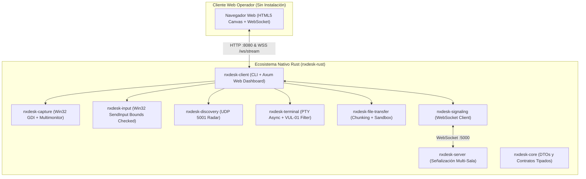

# 🖥️ NxDesk — Control, Streaming y Escritorio Remoto Nativo

<div align="center">

# ⚡ NxDesk
### Plataforma de Escritorio Remoto y Asistencia Técnica de Ultra-Baja Latencia
**Núcleo 100% Nativo en Rust (Axum 0.8 + Tokio + Win32 GDI + SIMD JPEG + CSPRNG)**  
*Acceso universal vía Web Dashboard (Zero-Install) y Servidor de Señalización Multi-Sala Autónomo.*

[](https://www.rust-lang.org/)
[](https://github.com/tokio-rs/axum)
[](deploy/docker/)
[](README.md#-7-seguridad-y-mitigaciones-owasp)
[](LICENSE)
[]()

[Visión General](#-1-visión-general-de-la-plataforma) •
[Características](#-2-características-principales) •
[Web Dashboard](#-3-panel-web-interactivo-dashboard-axum) •
[Arquitectura](#-4-arquitectura-del-sistema) •
[Estructura](#-5-estructura-del-repositorio) •
[Puesta en Marcha](#-6-puesta-en-marcha-y-guía-de-ejecución) •
[Seguridad y Mitigaciones](#-7-seguridad-y-mitigaciones-owasp) •
[Puertos y Conexión](#-8-configuración-de-red-y-enlaces-de-acceso)

</div>

---

## 🌐 1. Visión General de la Plataforma

**NxDesk** es una solución soberana y autónoma de control de escritorio remoto, retransmisión interactiva y soporte técnico de alto rendimiento, diseñada para operar de extremo a extremo sin depender de servidores propietarios ni plataformas cerradas en la nube.

El sistema proporciona:
1. **Streaming Directo en Memoria (< 15 ms de Latencia):** Captura acelerada Win32 GDI con compresión SIMD JPEG al vuelo y canal de retardo cero sincronizado con el refresco V-Sync del navegador (`requestAnimationFrame`).
2. **Acceso Web Zero-Install:** El operador o técnico puede visualizar y controlar la máquina remota desde cualquier navegador moderno (Edge, Chrome, Firefox, Safari) simplemente navegando a la URL del nodo, sin instalar clientes locales.
3. **Seguridad Local-First Endurecida:** Validación de sockets loopback reales (`ConnectInfo`) contra suplantación de cabeceras HTTP, control estricto de roles en WebSockets para inyección de periféricos, tokens criptográficos CSPRNG (192 bits), limitación de tasa (Rate Limiting) activa por IP y sandbox hermético para transferencia de archivos.

---

## ✨ 2. Características Principales

### ⚡ Streaming de Pantalla Nativo y Multimonitor Dinámico
* **Captura Win32 GDI con Enumeración de Hardware Real (`EnumDisplayMonitors`):** Detección nativa de monitores físicos individuales (Pantalla 1, Pantalla 2, etc.) y vista panorámica multimonitor, con soporte para disposiciones de monitores con coordenadas virtuales negativas.
* **Canal de Video de Capacidad 1 y Descarte Proactivo (Cero Buffer-Bloat):** Eliminación total del retraso acumulado; el servidor siempre descarta fotogramas atrasados y entrega en tiempo real el fotograma más fresco.
* **Conmutación Instantánea de Monitores:** Al seleccionar otra pantalla en el panel web, el flujo conmuta en menos de 50 milisegundos con redimensionamiento dinámico del canvas HTML5.
* **Compresión SIMD JPEG Optimizada:** Pipeline con aceleración vectorial nativa (AVX2/SSE) que reduce el tiempo de compresión a ~3 ms por fotograma, optimizando el ancho de banda a ~800 KB/s manteniendo el texto nítido.
* **Cursor Físico Integrado:** Dibujo en tiempo real del puntero nativo de Windows (`GetCursorInfo` + `DrawIconEx`) con sincronización exacta de coordenadas de hotspot.

### 🔐 Control de Acceso y Gestión de Clave de Anfitrión
* **Enmascaramiento Total de Contraseña:** La clave administrativa del anfitrión nunca se expone en texto plano en la API pública `/api/status`.
* **Protección contra Spoofing de Cabeceras:** El endpoint de entrega de credenciales valida la dirección IP física del socket (`addr.ip().is_loopback()`), impidiendo fugas de clave mediante manipulación de cabeceras HTTP `Host`.
* **Tokens Criptográficos de Sesión (CSPRNG):** Autenticación mediante tokens de 192 bits con entropía provista por el generador seguro del kernel del sistema operativo.

### 🎮 Inyección Segura de Entrada y Control Remoto
* **Normalización Precisa:** Mapeo matemático de coordenadas normalizadas `(0.0 a 1.0)` al espacio de resolución nativo de la pantalla seleccionada.
* **Emulación Completa de Ratón y Teclado:** Clics primarios, secundarios, centrales, arrastre, desplazamiento de rueda y pulsaciones de teclado con límites validados mediante Win32 `SendInput`.
* **Gating Estricto en WebSockets:** Las conexiones sin rol de control remoto autenticado tienen estrictamente bloqueada la inyección de periféricos.

### 🔍 Radar de Descubrimiento LAN (Broadcast UDP 5001)
* Detección automática en tiempo real de nodos NxDesk presentes en la misma subred física o virtual (Wi-Fi, Ethernet, Tailscale, ZeroTier).

### 📁 Explorador y Transferencia de Archivos con Sandbox Hermético
* Transferencia de archivos por bloques (*chunking*) asíncronos.
* **Sandbox Confinado:** Toda recepción de archivos y navegación está estrictamente confinada al directorio `Downloads/NxDesk_Transfers`, bloqueando de forma absoluta cualquier intento de Path Traversal (`../`) o acceso a rutas de sistema no autorizadas.

### 💻 Terminal Remota Segura (VUL-01 Mitigado)
* Sesión asíncrona PTY conectada a `cmd.exe` (Windows) o `/bin/bash` (Linux) con transmisión de salida en vivo y scroll suave.
* **Defensa Proactiva:** Bloqueo de comandos destructivos (`rm -rf`, `format`, `del /f`, `powershell -enc`), denegación estricta sin clave y necesidad de autorización explícita del anfitrión.

---

## 🖥️ 3. Panel Web Interactivo (Dashboard Axum)

El cliente en Rust (`nxdesk-client`) integra un servidor web impulsado por **Axum 0.8** y Tokio:

```text
┌────────────────────────────────────────────────────────────────────────┐
│  NxDesk Web Dashboard — http://localhost:8080                         │
├────────────────────────────────────────────────────────────────────────┤
│  [🖥️ Pantalla Remota]   [📡 Radar LAN]   [💻 Terminal]   [📂 Archivos]  │
├────────────────────────────────────────────────────────────────────────┤
│                                                                        │
│   Monitor: [Pantalla 1 (1920x1080) ▼]   [🕹️ Activar Control Remoto]   │
│                                                                        │
│   ┌──────────────────────────────────────────────────────────────┐     │
│   │                                                              │     │
│   │              CANVAS DE VIDEO STREAMING (60 FPS)              │     │
│   │                 (Inyección de Ratón & Teclado)               │     │
│   │                                                              │     │
│   └──────────────────────────────────────────────────────────────┘     │
│   ID del Equipo: 111-222-333   │   Espectadores: 1   │   Estado: OK    │
└────────────────────────────────────────────────────────────────────────┘
```

* **Acceso Local:** `http://localhost:8080`
* **Acceso desde otra máquina de la red:** `http://<IP_DEL_HOST>:8080`
* **Auto-Incremento de Puerto:** Si el puerto 8080 está en uso, el servidor busca y notifica automáticamente puertos correlativos disponibles (`8081`, `8082`, etc.).

---

## 🏛️ 4. Arquitectura del Sistema

El ecosistema NxDesk opera bajo un modelo desacoplado y concurrente:



---

## 📂 5. Estructura del Repositorio

```text
NxDesk/
├── nxdesk-rust/                           # Ecosistema Nativo en Rust (Workspace Principal)
│   ├── Cargo.toml                         # Workspace raíz (crates y aplicaciones integradas)
│   ├── apps/
│   │   ├── client/                        # Cliente nativo con Web Dashboard Axum integrado
│   │   │   ├── Cargo.toml                 # Dependencias (axum 0.8, tokio 1.38, rand, image)
│   │   │   └── src/
│   │   │       ├── main.rs                # Punto de entrada CLI y bucle de streaming SIMD
│   │   │       ├── web_server.rs          # Servidor Axum, rutas /api, WebSockets y UI
│   │   │       ├── state.rs               # AppState global con Rate Limiter por IP
│   │   │       └── auth.rs                # Gestor de tokens CSPRNG y roles de sesión
│   │   └── server/                        # Servidor de señalización multi-sala Tokio (puerto 5000)
│   └── crates/
│       ├── capture/                       # Captura Win32 GDI BitBlt y soporte multimonitor
│       ├── core/                          # DTOs tipados (SessionRole, AuthRequest, etc.)
│       ├── discovery/                     # Radar UDP broadcast en puerto 5001
│       ├── file-transfer/                 # Transferencia por bloques con sandbox confinado
│       ├── input/                         # Inyección Win32 SendInput con verificación de límites
│       ├── signaling/                     # Cliente WebSocket de señalización
│       └── terminal/                      # Terminal asíncrona interactiva con filtrado VUL-01
├── deploy/                                # Configuraciones de Despliegue en Producción
│   ├── caddy/                             # Reverse proxy TLS automático con Caddyfile
│   ├── docker/                            # Dockerfile multi-stage con healthcheck y Compose
│   ├── nginx/                             # Configuración Nginx para baja latencia
│   ├── systemd/                           # Unidad de servicio systemd para Linux
│   └── windows/                           # Scripts de instalación como Servicio Windows (NSSM)
├── .env.example                           # Plantilla de variables de entorno para despliegue
├── .gitignore                             # Reglas estrictas de higiene (bloqueo total de binarios)
└── README.md                              # Documentación principal del proyecto
```

---

## 🚀 6. Puesta en Marcha y Guía de Ejecución

### Requisitos del Sistema
* **Rust Toolchain:** `rustc` y `cargo` 1.85+ ([rustup.rs](https://rustup.rs/)).

---

### MODO 1: Cliente Standalone con Web Dashboard (Modo Local / LAN)

Es la forma más rápida y directa de compartir y controlar una máquina:

```powershell
# 1. Navegar al workspace de Rust
cd nxdesk-rust

# 2. Iniciar el cliente en modo compartir pantalla con contraseña administrativa
cargo run -p nxdesk-client -- --share --password=TuClaveSegura2026
```

Una vez iniciado el nodo:
1. Abre tu navegador web en: **`http://localhost:8080`**.
2. **Para conectarte desde otro equipo de la red:** Abre `http://<IP_DEL_HOST>:8080`.
3. Para controlar teclado y ratón, presiona **`👁️ Modo: Solo Vista`**, ingresa la clave de acceso configurada y el control remoto quedará habilitado de inmediato.

#### Parámetros CLI de `nxdesk-client`:
| Parámetro | Ejemplo | Descripción |
| :--- | :--- | :--- |
| `--id=<ID>` | `--id=111-222-333` | Asigna un identificador fijo al nodo. |
| `--share` | `--share` | Inicia automáticamente la captura y transmisión de pantalla. |
| `--password=<PW>` | `--password=Admin123` | Establece la clave administrativa para control remoto y terminal. |
| `--web-port=<PORT>`| `--web-port=9090` | Especifica el puerto HTTP del panel web (por defecto 8080). |
| `--allow-remote-terminal` | `--allow-remote-terminal` | Habilita la terminal remota al iniciar. |
| `--server=<URL>` | `--server=ws://192.168.1.10:5000/signalinghub` | URL del servidor de señalización central. |
| `--connect <ID>` | `--connect 222-333-444` | Se une automáticamente a la sala del equipo objetivo. |

---

### MODO 2: Conexión Remota de Dos Equipos con Servidor de Señalización

Para conectar dos equipos a través de un servidor central de señalización (en LAN o VPS):

```powershell
# PASO 1: En el servidor central, iniciar nxdesk-server (Puerto 5000)
cd nxdesk-rust
cargo run -p nxdesk-server

# PASO 2: En la Máquina A (Host que va a ser controlado)
cd nxdesk-rust
cargo run -p nxdesk-client -- --id=111-222-333 --share --password=Secreto123 --server ws://<IP_SERVIDOR>:5000/signalinghub

# PASO 3: En la Máquina B (Técnico / Operador)
# Opción A: Vía navegador abriendo http://<IP_MAQUINA_A>:8080
# Opción B: Vía cliente uniéndose a la sala:
cargo run -p nxdesk-client -- --connect 111-222-333 --server ws://<IP_SERVIDOR>:5000/signalinghub
```

---

### 🧪 Ejecución de Pruebas Unitarias y Linter

Para auditar la estabilidad y calidad del código en cualquier momento:

```powershell
cd nxdesk-rust

# Ejecutar las pruebas unitarias del workspace completo
cargo test --workspace

# Verificar cumplimiento de linter sin advertencias
cargo clippy --workspace -- -D warnings

# Validar formato de código
cargo fmt --check
```

---

### 🌐 6.1 Despliegue en Producción con Docker y TLS

Se incluye configuración lista para despliegue automatizado en [deploy/docker/](deploy/docker/):

```bash
# 1. Copiar y configurar variables de entorno
cp .env.example .env

# 2. Levantar el stack completo (nxdesk-server + Caddy con TLS automático)
cd deploy/docker
docker compose up -d
```

* **Servidor de Señalización:** Empaquetado en imagen multi-stage ultra-ligera (**32.4 MB**) con usuario sin privilegios `USER nxdesk` y sonda `HEALTHCHECK` activa.
* **Proxy Inverso TLS:** Caddy aprovisiona certificados SSL/TLS automáticos con Let's Encrypt para `https://nxdesk.tu-dominio.com` y WebSockets seguros (`wss://`).

---

## 🛡️ 7. Seguridad y Mitigaciones OWASP

El proyecto cuenta con controles activos y verificados frente a vectores de ataque comunes:

* **Mitigación SEC-01 (Protección contra Host Header Spoofing):**  
  Implementada en [apps/client/src/web_server.rs](nxdesk-rust/apps/client/src/web_server.rs). La entrega de credenciales administrativas no confía en encabezados HTTP manipulables; valida la dirección física del socket TCP (`addr.ip().is_loopback()`), impidiendo fugas de clave a atacantes de red.
* **Mitigación SEC-02 (Gating Estricto en WebSockets):**  
  Implementada en [apps/client/src/web_server.rs](nxdesk-rust/apps/client/src/web_server.rs). Toda inyección de periféricos (`InputEvent`) y streaming de video está bloqueada salvo que la conexión cuente con un token de sesión validado con rol `SessionRole::FullControl`.
* **Mitigación SEC-03 (Confinamiento de Archivos y Anti-Path Traversal):**  
  Implementada en [crates/file-transfer/src/lib.rs](nxdesk-rust/crates/file-transfer/src/lib.rs). La navegación de archivos requiere autenticación y queda estrictamente restringida a `Downloads/NxDesk_Transfers`, bloqueando secuencias relativas (`..`) o rutas arbitrarias del disco duro.
* **Mitigación SEC-04 (Tokens Criptográficos CSPRNG):**  
  Implementada en [apps/client/src/auth.rs](nxdesk-rust/apps/client/src/auth.rs). Los tokens de sesión se generan mediante el generador criptográfico del kernel (192 bits de entropía), eliminando identificadores predecibles basados en reloj.
* **Mitigación SEC-05 (Cero Contraseñas por Defecto):**  
  Se eliminaron contraseñas estáticas en fallback. El desbloqueo de la terminal remota requiere obligatoriamente una clave configurada explícitamente en el arranque.
* **Mitigación SEC-06 (Rate Limiting Anti-Fuerza Bruta):**  
  Implementada en [apps/client/src/state.rs](nxdesk-rust/apps/client/src/state.rs). Limita los intentos en `/api/auth` (máx. 5 intentos cada 10 s por IP) y conexiones WebSocket repetitivas, mitigando ataques de diccionario e inundación DoS.
* **Mitigación VUL-01 (Filtrado de Comandos Destructivos):**  
  Implementada en [crates/terminal/src/lib.rs](nxdesk-rust/crates/terminal/src/lib.rs). Bloquea comandos como `rm -rf`, `format`, `del /f`, `powershell -enc` en terminales interactivas.

---

## 🔌 8. Configuración de Red y Enlaces de Acceso

| Recurso / Servicio | Puerto y Protocolo | URL / Destino | Propósito |
| :--- | :--- | :--- | :--- |
| **Web Dashboard** | `TCP :8080` (HTTP) | `http://localhost:8080/` | Panel de control web y streaming para el operador. |
| **WebSocket Stream** | `TCP :8080` (WS/WSS) | `ws://localhost:8080/ws/stream` | Canal de retransmisión de vídeo JPEG y control autenticado. |
| **Servidor de Señalización** | `TCP :5000` (WS) | `ws://localhost:5000/signalinghub` | Enrutamiento de salas y señalización multi-nodo en Rust. |
| **Radar LAN Broadcast** | `UDP :5001` | `255.255.255.255:5001` | Descubrimiento automático de equipos en la subred local. |

---

## 📄 9. Licencia

Distribuido bajo la licencia **MIT**. Consulta el archivo `LICENSE` para mayores detalles.