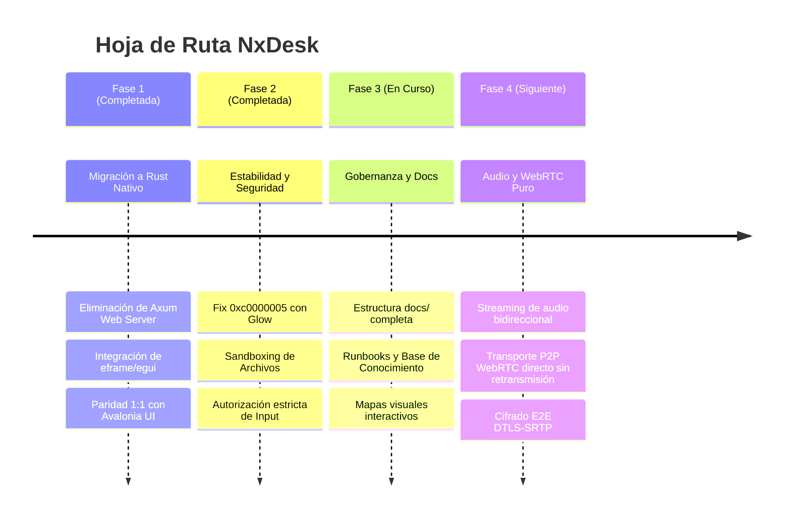

# 🗺️ Roadmap de Evolución — NxDesk

| Código | OVR-RDM-001 | Versión | v1.0 |
|--------|-------------|---------|------|
| Actualizado | 2026-10-28 | Autor | NxDesk Product & Architecture Team |
| Estado | Aprobado | Clasificación | Documentación Técnica Oficial |

---

## 📅 Hitos del Proyecto

---

## Detalle por Versiones

### Versión 1.0.0 (Actual - Estable & 100% Rust Nativo)
* [x] Aplicación de escritorio nativa en Rust (`nxdesk-client`) con tema oscuro Dark `#1E1E1E` y `#007ACC`.
* [x] Reemplazo de backend gráfico `wgpu` por `Glow (OpenGL)` resolviendo el crash `STATUS_ACCESS_VIOLATION`.
* [x] Protocolo de solicitud/aceptación de sesión AnyDesk en caliente con modal `ConnectionTypeDialog`.
* [x] Widget flotante de anfitrión `HostDisconnectWindow` con cronómetro en vivo y botón desconectar.
* [x] Decomisión total del código legacy C# (.NET) completando la migración 100% nativa en Rust.
* [x] Interactividad total de control remoto en visor egui (ratón con coordenadas 0.0-1.0, clicks, rueda, teclado VK y portapapeles).
* [x] Erradicación de fugas de recursos:
  * Memoria/VRAM: Prevención de texture churn con secuencia atómica `frame_sequence` y `set(...)`.
  * RAM: Búfer de salida del terminal acotado a 64 KB.
  * Disco: Purgado automático de transferencias de archivos canceladas y huérfanas.
  * Procesos: Implementación de `Drop` en `TerminalSession` garantizando 0 procesos zombies.
* [x] Suite de pruebas automatizadas con 19 tests unitarios y de integración E2E en verde.
* [x] Linter estricto con 0 advertencias (`cargo clippy --workspace --tests -- -D warnings`).

### Versión 1.1.0 (Planificada)
* [ ] Compresión por hardware H.264 / AV1 mediante NVENC y QuickSync.
* [ ] Negociación P2P WebRTC ICE/STUN/TURN para conexión directa sin retransmisión en servidor.

### Versión 1.2.0 (Futura)
* [ ] Transmisión y reproducción de audio de sistema en tiempo real.
* [ ] Soporte para clientes móviles (Android/iOS) con la misma arquitectura de señalización.
