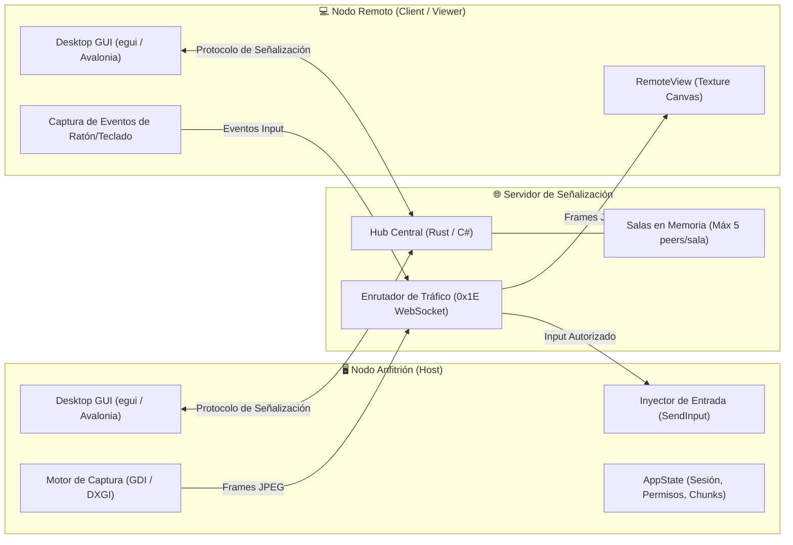

# 🏗️ Visión General de la Arquitectura — NxDesk

| Código | ARC-OVR-001 | Versión | v1.0 |
|--------|-------------|---------|------|
| Actualizado | 2026-10-28 | Autor | NxDesk Chief Architecture Officer |
| Estado | Aprobado | Clasificación | Documentación Técnica Oficial |

---

## 1. Topología del Sistema

El ecosistema NxDesk está diseñado como una arquitectura distribuida orientada a eventos, con tres componentes clave que interactúan entre sí:

---

## 2. Los Dos Ecosistemas del Proyecto

NxDesk implementa dos variantes de ejecución alineadas con los mismos contratos de red y la misma experiencia de usuario:

### A. Ecosistema Rust (`nxdesk-rust/`)
* **`apps/client`:** Aplicación de escritorio nativa pura en Rust (`egui` + `eframe` Glow). Gestiona la interfaz, la conexión con el servidor de señalización, el pipeline de captura y la recepción de pantalla remota.
* **`apps/server`:** Servidor de señalización ultraliviano asíncrono en Rust basado en `tokio-tungstenite`. Concurrencia masiva con consumo menor a 15 MB de RAM.
* **`crates/`:** Librerías desacopladas reutilizables (`core`, `capture`, `input`, `file-transfer`, `terminal`, `discovery`, `signaling`).

### B. Ecosistema C# (.NET 10.0) (`src/`)
* **`NxDesk.Client`:** Aplicación de escritorio multiplataforma con Avalonia UI 11.3 y patrón MVVM reactivo (`CommunityToolkit.Mvvm`).
* **`NxDesk.Server`:** Servidor de señalización y APIs con ASP.NET Core SignalR.
* **`NxDesk.Infrastructure`:** Implementaciones nativas de hardware en Windows con SharpDX (DirectX 11 DXGI Desktop Duplication) y Win32 API.
* **`NxDesk.Application` / `NxDesk.Core`:** Contratos de servicio, DTOs y reglas de negocio independientes de la UI.

---

## 3. Protocolos de Red y Canales de Comunicación

1. **Canal de Señalización (WebSocket TCP):**
   * Puerto por defecto: `5000`.
   * Enmarcado: Tráfico JSON delimitado por el byte `0x1E` (SignalR Compatible).
   * Contenido: Handshake de sala, ofertas/respuestas de sesión AnyDesk, conmutación de pantallas y comandos de terminal.
2. **Canal de Streaming de Video (Frames Binarios):**
   * Retransmisión de fotogramas comprimidos en JPEG como mensajes binarios directos sobre el WebSocket, eliminando el overhead de codificación Base64.
3. **Canal de Descubrimiento LAN (UDP Broadcast):**
   * Puerto fijo: `5001`.
   * Dirección: `255.255.255.255`.
   * Balizas periódicas con la identidad del nodo (`PeerIdentity`: alias, IP, puerto, estado en línea).
