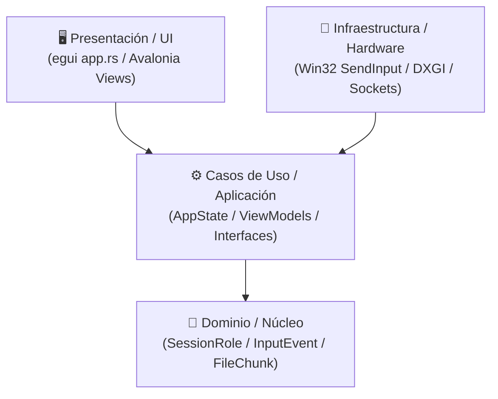

# 🏛️ Clean Architecture y Separación de Capas — NxDesk

| Código | ARC-CLN-001 | Versión | v1.0 |
|--------|-------------|---------|------|
| Actualizado | 2026-10-28 | Autor | NxDesk Chief Architecture Officer |
| Estado | Aprobado | Clasificación | Documentación Técnica Oficial |

---

## 1. La Regla de Dependencia

El diseño de NxDesk se rige por la **Regla de Dependencia de Clean Architecture / Arquitectura Hexagonal**: las dependencias en el código fuente solo pueden apuntar **hacia adentro**, hacia las políticas de dominio y aplicación de mayor abstracción. Las capas externas (UI, drivers de GPU, Win32 API, sockets) nunca deben contaminar las entidades o casos de uso.

---

## 2. Correspondencia de Capas en la Solución

### Ecosistema C# (.NET)
| Capa Clean Architecture | Proyecto | Responsabilidades |
| :--- | :--- | :--- |
| **Dominio (Core)** | `NxDesk.Core` | Modelos fundamentales (`SignalingMessage`, `SessionRole`, `DeviceCardModel`), contratos puros sin dependencias externas. |
| **Aplicación (Application)** | `NxDesk.Application` | Interfaces de puertos (`IScreenCaptureService`, `IInputInjectionService`, `IFileTransferService`, `IRemoteTerminalService`), DTOs de transferencia y validadores. |
| **Infraestructura (Infrastructure)** | `NxDesk.Infrastructure` | Adaptadores concretos con librerías nativas (`DesktopDuplicationCaptureService` con SharpDX, `WindowsInputInjectionService` con `user32.dll`, `FileTransferService`). |
| **Presentación (Presentation)** | `NxDesk.Client` | Avalonia UI XAML (`MainWindow.axaml`, `HomeView.axaml`), ViewModels MVVM reactivos y diálogos modales. |

### Ecosistema Rust
| Capa Clean Architecture | Módulo / Crate | Responsabilidades |
| :--- | :--- | :--- |
| **Dominio (Core)** | `crates/core` | Estructuras de datos puras (`SignalingMessage`, `InputEvent`, `ActiveSessionInfo`, `FileChunk`), serialización Serde. |
| **Aplicación / Casos de Uso** | `apps/client/src/state.rs` | Coordinador global `AppState`, gestión de permisos en memoria, handshake AnyDesk, rate-limiting e inmutabilidad de sesión. |
| **Adaptadores de Infraestructura** | `crates/capture`, `crates/input`, `crates/file-transfer`, `crates/terminal` | Implementación con APIs nativas del SO: Win32 GDI, `SendInput`, lectura/escritura asíncrona de archivos con Tokio, tuberías PTY. |
| **Presentación** | `apps/client/src/app.rs` | Bucle de pintado inmediato `eframe::App`, renderizado con paleta `#1E1E1E` y `#007ACC`, canvas de textura acelerado por GPU. |

---

## 3. Beneficios Comprobados
1. **Sustituibilidad de Drivers de Hardware:** Se pudo migrar el backend de renderizado de `wgpu` a `Glow (OpenGL)` sin tocar una sola línea de la lógica de red o del protocolo de control.
2. **Testabilidad Aislada:** Las pruebas unitarias de `state.rs`, `core` y `file-transfer` se ejecutan en milisegundos en memoria sin requerir tarjetas gráficas ni monitores conectados.
3. **Mantenibilidad:** Desacoplamiento total entre las dos opciones de cliente (Rust y C#), permitiendo que compartan los mismos esquemas de mensajes y contratos de interoperabilidad.
