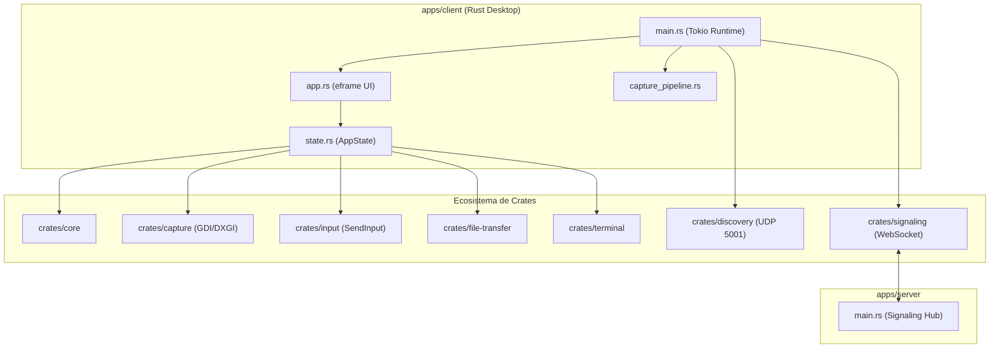

# 🧩 Componentes del Sistema — NxDesk

| Código | ARC-CMP-001 | Versión | v1.0 |
|--------|-------------|---------|------|
| Actualizado | 2026-10-28 | Autor | NxDesk Chief Architecture Officer |
| Estado | Aprobado | Clasificación | Documentación Técnica Oficial |

---

## 1. Desglose de Componentes Principales

---

## 2. Descripción Funcional de Componentes

### 1. `apps/client` (Cliente de Escritorio Nativo)
* **`app.rs`:** Componente de interfaz de usuario egui. Implementa el Header AnyDesk, la sección "Este puesto de trabajo", la sección "Descubierto" con tarjetas `DeviceCard`, el canvas de lienzo remoto `RemoteView`, y los modales `ConnectionTypeDialog` y `HostDisconnectWindow`.
* **`state.rs`:** Contenedor de estado compartido multihilo (`AppState`). Maneja locks `RwLock` y `Mutex`, almacena fotogramas JPEG, identidades de pares descubiertos y controla la sesión activa.
* **`capture_pipeline.rs`:** Bucle asíncrono desacoplado que realiza la captura de pantalla periódica a los FPS configurados, comprime a JPEG y transmite únicamente cuando hay pares conectados.

### 2. `apps/server` (Servidor de Señalización)
* **`main.rs`:** Servidor HTTP/WebSocket ultraligero que implementa el protocolo SignalR (`0x1E`). Administra el registro de clientes por ID de conexión, la asociación a salas y la retransmisión de mensajes de texto y frames binarios.

### 3. Crates Especializados
* **`crates/core`:** Modelos canónicos (`SignalingMessage`, `InputEvent`, `ActiveSessionInfo`, `FileChunk`).
* **`crates/capture`:** Capturador de pantalla nativo Win32 con GDI / GetDIBits y codificación JPEG con `image` crate.
* **`crates/input`:** Inyector de eventos de entrada Win32 `SendInput` con escalado de coordenadas normalizadas (0.0 a 1.0).
* **`crates/file-transfer`:** Gestor de lectura/escritura de archivos fragmentados con verificación de sandbox en tiempo real.
* **`crates/terminal`:** Subsistema de terminal virtual PTY para ejecución de comandos de diagnóstico.
* **`crates/discovery`:** Radar UDP en el puerto `5001` con sockets duales (Listener + Broadcaster) para descubrimiento automático en LAN.
* **`crates/signaling`:** Cliente WebSocket cliente-servidor con reconexión automática y soporte de SignalR.
