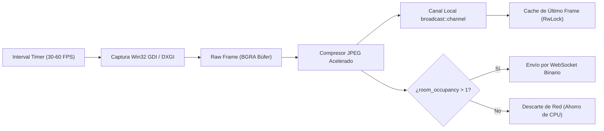

# 🎥 Módulo: Pipeline de Captura de Pantalla y Streaming — NxDesk

| Código | MOD-CAP-001 | Versión | v1.0 |
|--------|-------------|---------|------|
| Actualizado | 2026-10-28 | Autor | NxDesk Video & Systems Engineering |
| Estado | Aprobado | Clasificación | Documentación Técnica Oficial |

---

## 1. Arquitectura del Pipeline de Captura

El pipeline de captura opera de forma completamente desacoplada de la interfaz gráfica principal en una tarea asíncrona dedicada (`capture_pipeline.rs`). Esto garantiza que una alta carga de renderizado en la UI no introduzca tirones (stutter) en el video transmitido al cliente remoto.

---

## 2. Tecnologías de Captura por Plataforma

### Windows (Ecosistema C#)
* Utiliza **DirectX 11 DXGI Desktop Duplication API** (`DesktopDuplicationCaptureService.cs`).
* Los fotogramas se leen directamente desde la memoria de video de la GPU (VRAM) sin necesidad de transferir datos por el bus PCIe hasta la CPU, permitiendo alcanzar 60 FPS estables con < 3% de uso de CPU.

### Windows (Ecosistema Rust)
* Utiliza **Win32 GDI (`GetDC`, `CreateCompatibleBitmap`, `GetDIBits`)** en `crates/capture/src/lib.rs`.
* Ofrece máxima compatibilidad en cualquier edición de Windows (incluyendo entornos virtualizados, RDP anidado o PCs sin soporte DirectX 11).

---

## 3. Optimizaciones de Rendimiento y Memoria
1. **Compresión Adaptativa:** La calidad JPEG (`quality`) se ajusta entre 10 y 100 según el ancho de banda y la configuración del usuario (por defecto: `75`).
2. **Eliminación de Clonaciones Redundantes:** Los fotogramas comprimidos se transfieren por propiedad (`move`) hacia el socket de red, eliminando copias innecesarias en la memoria RAM.
3. **Envío Condicional Inteligente:** Si el anfitrión no tiene ningún operador conectado a su sala (`room_occupancy <= 1`), el streaming de red se pausa automáticamente, conservando ancho de banda y batería.
