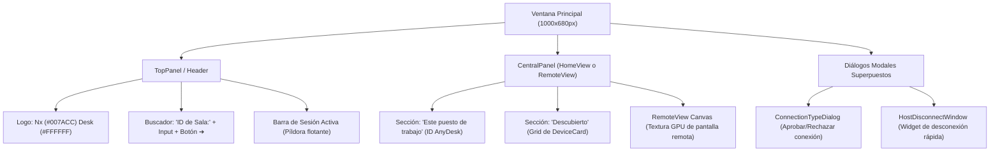

# 🎨 Componentes de Interfaz de Usuario — NxDesk

| Código | MOD-CLI-003 | Versión | v1.0 |
|--------|-------------|---------|------|
| Actualizado | 2026-10-28 | Autor | NxDesk Desktop Engineering Team |
| Estado | Aprobado | Clasificación | Documentación Técnica Oficial |

---

## 1. Jerarquía de Componentes Visuales (`app.rs` / `MainWindow.axaml`)

---

## 2. Descripción de Componentes Clave

### A. Encabezado (Header Bar)
* **Logo NxDesk:** Tipografía en negrita (`Nx` estilizado en azul `#007ACC`, `Desk` en blanco).
* **Búsqueda Central:** Campo de entrada para digitar el ID o la IP del par al que se desea conectar, acompañado del botón de conexión rápida `➔`.
* **Píldora de Sesión Activa:** Cuando existe una sesión en curso, el encabezado muestra el ID del equipo remoto conectado, indicadores de estado de periféricos y el botón rojo de desconexión rápida `#D13438`.

### B. Sección "Este puesto de trabajo"
* Tarjeta destacada con fondo `#252526` y bordes `#333333`.
* Presenta el **ID de AnyDesk** local en texto grande azul `#007ACC` (formato canónico `111-222-333`).
* Botón **Copiar ID** (`📋`) para transferir el identificador al portapapeles del sistema operativo.
* Toggle de visualización de contraseña de acceso no asistido (`👁`).

### C. Tarjetas de Equipos Descubiertos (`DeviceCard`)
* Disposición en cuadrícula responsiva (Grid).
* Punto indicador de presencia: `#00CC66` (En Línea).
* Nombre del host en negrita, acompañado del ID de sala y la dirección IP detectada en LAN.
* Botón `🔒 Conectar` con esquinas redondeadas y micro-animación en hover.

### D. Diálogo Modal de Conexión (`ConnectionTypeDialog`)
* Se superpone al centro de la ventana cuando un par solicita sesión.
* Informa el alias, el ID y la IP del solicitante.
* Permite seleccionar el rol a conceder (`Control Total`, `Solo Ver`, `Solo Archivos`).
* Botón verde **Aceptar** y botón rojo **Rechazar**.
