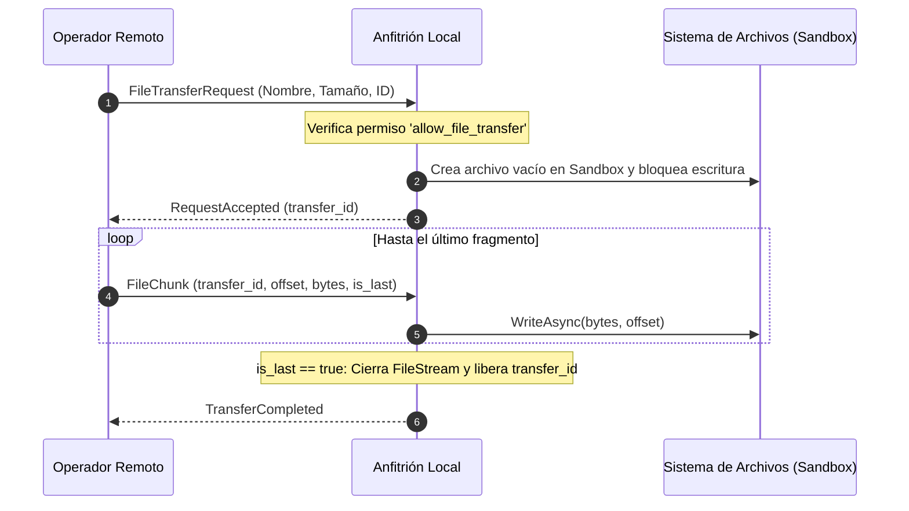

# 📁 Módulo: Transferencia de Archivos — NxDesk

| Código | MOD-FLT-001 | Versión | v1.0 |
|--------|-------------|---------|------|
| Actualizado | 2026-10-28 | Autor | NxDesk Core Architecture Team |
| Estado | Aprobado | Clasificación | Documentación Técnica Oficial |

---

## 1. Propósito y Modelo de Fragmentación
El módulo de **Transferencia de Archivos** (`FileTransferService.cs` en C# y `crates/file-transfer` en Rust) permite enviar y recibir ficheros y directorios completos entre el anfitrión y el operador remoto de manera resiliente ante micro-cortes de red.

Para evitar saturar la memoria RAM con archivos de gran tamaño (e.g. instaladores, imágenes ISO o videos), los archivos se dividen en fragmentos denominados **Chunks**:

```json
{
  "transfer_id": "a9d7c814-1234-4a56-87ef-abcdef012345",
  "file_name": "actualizacion.zip",
  "relative_path": "parches/v1.0",
  "offset": 131072,
  "data": "...base64_o_bytes...",
  "is_last": false,
  "checksum": "sha256_hash_opcional"
}
```

---

## 2. Ciclo de Vida de una Transferencia



---

## 3. Seguridad y Confinamiento
La lectura, subida o listado de archivos está estrictamente supeditada al cumplimiento de la política de Sandboxing. Para más información técnica, ver:  
👉 **[sandbox.md](file:///c:/Users/User/Downloads/nxDesk/NxDesk/NxDesk/docs/02-modules/file-transfer/sandbox.md)**
