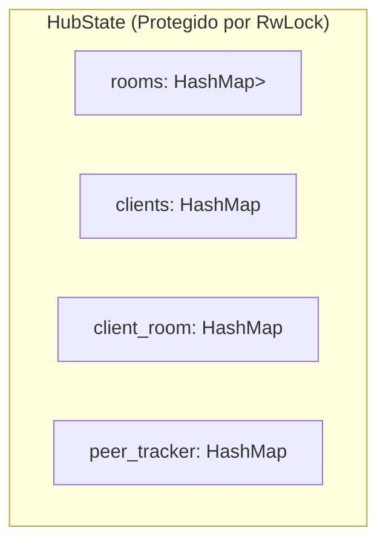

# 🌐 Módulo: Servidor de Señalización — NxDesk

| Código | MOD-SRV-001 | Versión | v1.0 |
|--------|-------------|---------|------|
| Actualizado | 2026-10-28 | Autor | NxDesk Backend Architecture Team |
| Estado | Aprobado | Clasificación | Documentación Técnica Oficial |

---

## 1. Propósito y Responsabilidades
El **Servidor de Señalización** (implementado tanto en Rust `nxdesk-rust/apps/server` como en C# `src/NxDesk.Server`) actúa como el intermediario de red para que los clientes remotos se descubran, negocien parámetros de sesión y retransmitan paquetes en tiempo real.

Sus responsabilidades esenciales son:
1. Mantener conexiones WebSocket persistentes y bidireccionales con los clientes.
2. Gestionar el ciclo de vida de las **Salas (Rooms)** identificadas por IDs alfanuméricos.
3. Limitar la cantidad máxima de conexiones simultáneas por sala (máx 5 participantes).
4. Retransmitir mensajes de control JSON (delimitados por `0x1E`) y paquetes binarios de video JPEG.
5. Gestionar la limpieza inmediata de recursos y notificación de salida cuando un cliente se desconecta.

---

## 2. Arquitectura de Estado en Memoria (`HubState`)

* **`rooms`:** Agrupa las conexiones por identificador de sala.
* **`clients`:** Asocia cada ID de conexión único a su canal emisor (`mpsc::UnboundedSender<Message>`).
* **`client_room`:** Permite identificar en $O(1)$ a qué sala pertenece un cliente para validar retransmisiones.
* **`peer_tracker`:** Rastrea qué cliente físico es el propietario/anfitrión actual de cada sala.
