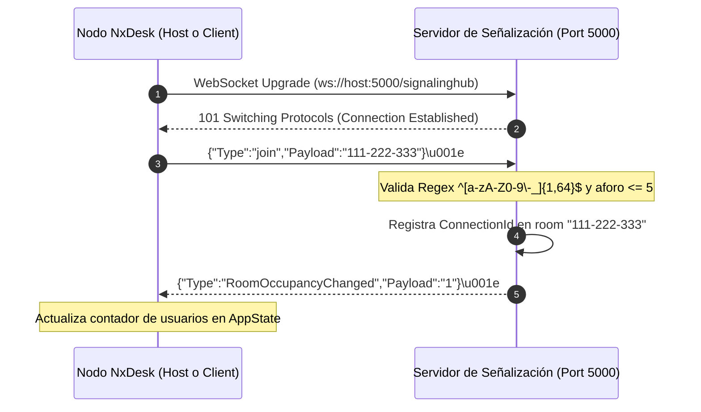

# 🔄 Flujo E2E: Conexión y Unión a Salas de Señalización — NxDesk

| Código | FLW-CON-002 | Versión | v1.0 |
|--------|-------------|---------|------|
| Actualizado | 2026-10-28 | Autor | NxDesk Protocol Engineering Team |
| Estado | Aprobado | Clasificación | Documentación Técnica Oficial |

---

## 1. Ciclo de Negociación de Sala

---

## 2. Salida y Desconexión Abrupta

Cuando un nodo cierra la aplicación, pierde la red o invoca explícitamente `leave`:
1. El WebSocket emite una trama `Close` o el socket TCP se interrumpe (`EOF`).
2. El servidor ejecuta inmediatamente `cleanup_connection(conn_id)`:
   * Remueve la conexión de `s.clients` y del mapa `s.rooms[room_id]`.
   * Calcula la nueva ocupación restante.
   * Si la sala aún tiene miembros, difunde el evento `RoomOccupancyChanged` con el nuevo total.
   * Si la sala quedó vacía, destruye la entrada del mapa para liberar memoria.
