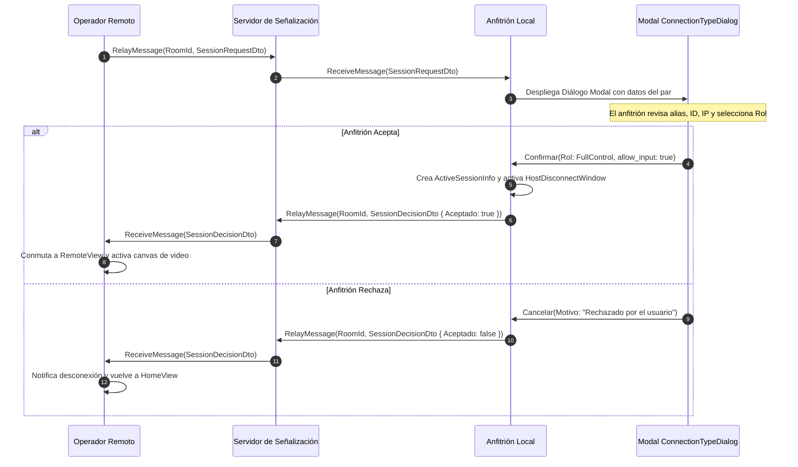

# 🔄 Flujo E2E: Handshake de Sesión AnyDesk — NxDesk

| Código | FLW-CON-001 | Versión | v1.0 |
|--------|-------------|---------|------|
| Actualizado | 2026-10-28 | Autor | NxDesk Protocol Engineering Team |
| Estado | Aprobado | Clasificación | Documentación Técnica Oficial |

---

## 1. Diagrama de Secuencia E2E



---

## 2. Contratos de Mensajes del Handshake

### `SessionRequestDto`
```json
{
  "RequestId": "req-98765",
  "RequesterId": "222-333-444",
  "RequesterAlias": "Soporte TI - Laptop",
  "RequestedRole": "FullControl",
  "Timestamp": 1730105000
}
```

### `SessionDecisionDto`
```json
{
  "RequestId": "req-98765",
  "IsAccepted": true,
  "GrantedRole": "FullControl",
  "RejectionReason": null,
  "AllowInput": true,
  "AllowClipboard": true,
  "AllowFileTransfer": true,
  "SessionToken": "tok-abc123xyz"
}
```
