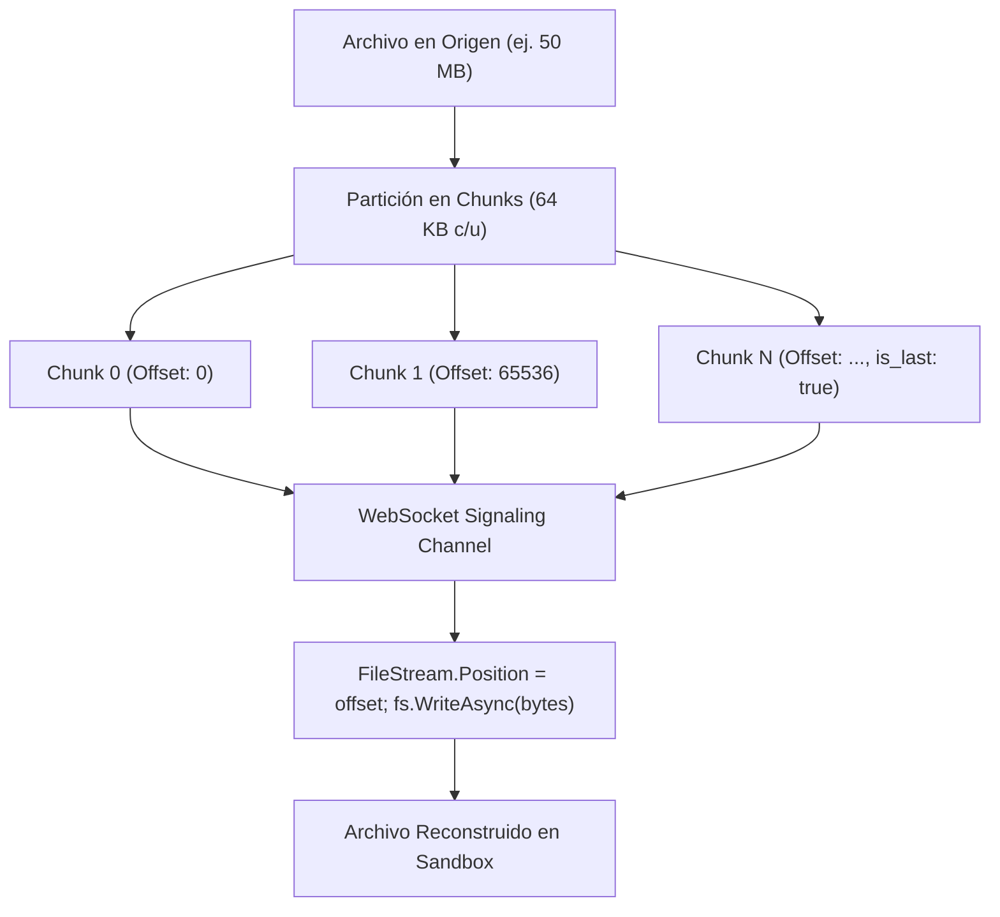

# 🔄 Flujo E2E: Transferencia de Archivos por Fragmentos (Chunks) — NxDesk

| Código | FLW-FLT-001 | Versión | v1.0 |
|--------|-------------|---------|------|
| Actualizado | 2026-10-28 | Autor | NxDesk Core Architecture Team |
| Estado | Aprobado | Clasificación | Documentación Técnica Oficial |

---

## 1. Algoritmo de Fragmentación y Transmisión

---

## 2. Controles de Integridad y Robustez

1. **Escritura No Bloqueante Asíncrona:** Tanto en C# como en Rust, las operaciones de disco se delegan al pool de hilos de I/O (`tokio::fs` o `FileStream.WriteAsync`).
2. **Desplazamiento Explícito (Seek):** Cada chunk viaja con su `offset` absoluto, permitiendo que fragmentos recibidos fuera de orden o reintentados se escriban exactamente en su posición correcta del archivo sin corromperlo.
3. **Liberación Garantizada de Descriptores:** Al recibir `is_last: true`, el descriptor de archivo (`FileStream` o `tokio::fs::File`) se cierra y se elimina la referencia del mapa `_activeTransfers`.
