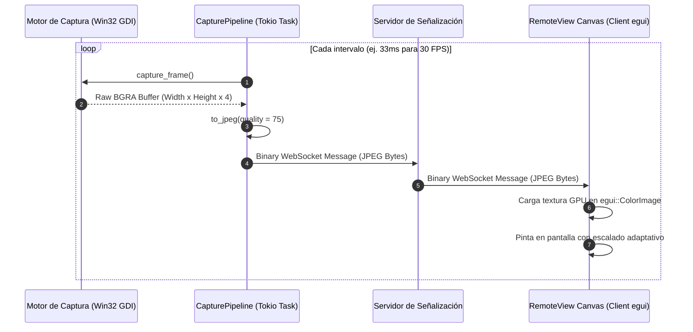

# 🔄 Flujo E2E: Streaming de Video y Retransmisión de Frames — NxDesk

| Código | FLW-STR-001 | Versión | v1.0 |
|--------|-------------|---------|------|
| Actualizado | 2026-10-28 | Autor | NxDesk Video & Systems Engineering |
| Estado | Aprobado | Clasificación | Documentación Técnica Oficial |

---

## 1. Ciclo de Vida del Frame de Video

---

## 2. Parámetros Técnicos de Transmisión

* **Formato de Color Nativo:** BGRA 32-bit (8 bits por canal).
* **Compresión de Salida:** JPEG estándar con codificación acelerada por software en `crates/capture`.
* **Tamaño Promedio por Frame:** Entre 45 KB y 180 KB dependiendo de la complejidad visual de la pantalla (texto estático vs. video en movimiento).
* **Ancho de Banda Típico:** 1.5 Mbps a 6.0 Mbps para 1080p a 30 FPS.
