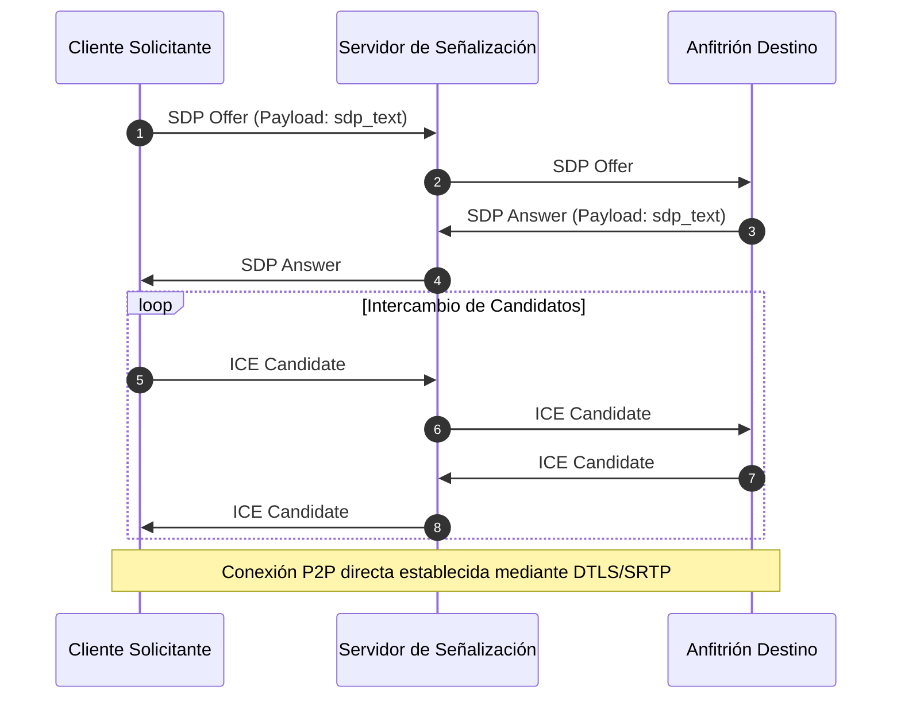

# 🌐 Integración: Arquitectura WebRTC y Negociación P2P — NxDesk

| Código | INT-RTC-001 | Versión | v1.0 |
|--------|-------------|---------|------|
| Actualizado | 2026-10-28 | Autor | NxDesk Network & Protocols Team |
| Estado | Aprobado | Clasificación | Documentación Técnica Oficial |

---

## 1. Rol Actual de WebRTC en NxDesk

En la arquitectura actual de NxDesk:
* La **Señalización (Signaling)** opera mediante WebSockets / SignalR.
* La transmisión de datos de video, input y chunks se canaliza mediante sockets TCP/WebSocket de alta velocidad, garantizando entrega confiable y compatibilidad universal con firewalls corporativos.
* La infraestructura de mensajes (`SignalingMessage`) incluye los campos reservados para el intercambio de descriptores SDP (`offer`, `answer`) y candidatos ICE (`ice_candidate`) para futuras fases de transporte P2P directo vía UDP/SCTP.

---

## 2. Negociación de Candidatos ICE (Fase Futura)

