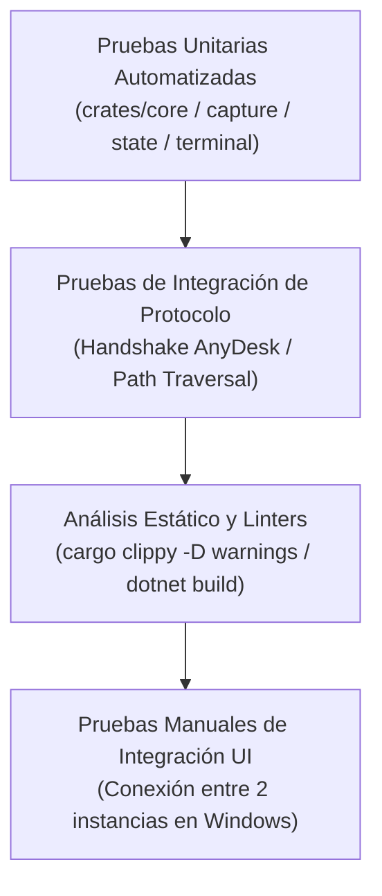

# 🧪 Estrategia de Pruebas y Aseguramiento de Calidad — NxDesk

| Código | TST-STR-001 | Versión | v1.0 |
|--------|-------------|---------|------|
| Actualizado | 2026-10-28 | Autor | NxDesk QA & Governance Team |
| Estado | Aprobado | Clasificación | Documentación Técnica Oficial |

---

## 1. Pirámide de Pruebas

---

## 2. Puertas de Aprobación de Calidad (Quality Gates)

Para que cualquier Pull Request o cambio sea aprobado e incorporado a la rama principal:
1. **Gate 1 (Pruebas Unitarias):** El 100% de las pruebas unitarias automatizadas deben pasar sin fallas (`cargo test --workspace`).
2. **Gate 2 (Linter Estricto):** Cero advertencias con denegación explícita (`cargo clippy --workspace -- -D warnings`).
3. **Gate 3 (Compilación Limpia .NET):** Compilación limpia sin errores ni advertencias de paquetes vulnerables (`dotnet build NxDesk.slnx`).
4. **Gate 4 (Impacto GitNexus):** Verificación de radio de impacto (Blast Radius) en llamadas upstream/downstream.
