# 📘 NxDesk Documentation Portal

| Código | DOC-PORTAL-001 | Versión | v1.0 |
|--------|----------------|---------|------|
| Actualizado | 2026-10-28 | Autor | NxDesk Core Architecture Team |
| Estado | Aprobado | Clasificación | Documentación Técnica Oficial |

Bienvenido al portal oficial de documentación técnica, operativa y arquitectónica de **NxDesk**.  
Este sistema documental sigue el estándar institucional definido en `guide_knowledge/` y se mantiene bajo control de versiones sincronizado con el código fuente del proyecto.

---

## 🗺️ Mapa de Navegación del Sistema Documental

```mermaid
graph TD
    Root["docs/"] --> O["00-overview/ (Propósito y Alcance)"]
    Root --> A["01-architecture/ (Diseño y ADRs)"]
    Root --> M["02-modules/ (Especificación de Módulos)"]
    Root --> F["03-flows/ (Flujos de Proceso E2E)"]
    Root --> S["04-database/ (Estado y Persistencia)"]
    Root --> I["05-integrations/ (Protocolos y Win32 API)"]
    Root --> Inf["06-infrastructure/ (Servicios, Docker, Nginx)"]
    Root --> Op["07-operations/ (Despliegue y Runbooks)"]
    Root --> U["08-user-guides/ (Guías de Usuario)"]
    Root --> V["09-visual-docs/ (Mapas Interactivos HTML)"]
    Root --> KB["10-knowledge-base/ (Base de Conocimiento)"]
    Root --> Inc["11-incidents/ (Bugs y Lecciones)"]
    Root --> Sec["12-security/ (Blindaje y Mitigaciones)"]
    Root --> T["13-testing/ (Estrategia y Suites de Pruebas)"]
    Root --> C["14-changelog/ (Historial de Versiones)"]
    Root --> R["99-reference/ (Chuletas de Referencia Rápida)"]
```

---

## 📂 Directorio Rápido de Secciones

| Índice | Sección | Contenido Principal | Formato |
| :---: | :--- | :--- | :---: |
| **00** | [00-overview](file:///c:/Users/User/Downloads/nxDesk/NxDesk/NxDesk/docs/00-overview/project-overview.md) | Visión, objetivos, alcance (qué hace / qué NO hace) y glosario técnico. | Markdown |
| **01** | [01-architecture](file:///c:/Users/User/Downloads/nxDesk/NxDesk/NxDesk/docs/01-architecture/architecture-overview.md) | Clean Architecture, componentes, dependencias y registros de decisión arquitectónica (ADRs). | Markdown + Diagramas |
| **02** | [02-modules](file:///c:/Users/User/Downloads/nxDesk/NxDesk/NxDesk/docs/02-modules/client-desktop/overview.md) | Cliente de escritorio nativo (Rust/egui + C#/Avalonia), servidor de señalización, captura, archivos y terminal. | Markdown |
| **03** | [03-flows](file:///c:/Users/User/Downloads/nxDesk/NxDesk/NxDesk/docs/03-flows/connection/session-handshake.md) | Flujos E2E: Handshake de sesión AnyDesk, streaming de frames JPEG, transferencia y comandos. | Markdown + Mermaid |
| **04** | [04-database](file:///c:/Users/User/Downloads/nxDesk/NxDesk/NxDesk/docs/04-database/state-management.md) | Gestión del estado concurrente en memoria, sincronización RwLock/Atomic y persistencia de configuración. | Markdown |
| **05** | [05-integrations](file:///c:/Users/User/Downloads/nxDesk/NxDesk/NxDesk/docs/05-integrations/signalr/protocol.md) | Protocolo SignalR (0x1E), canales de datos WebSocket y enlace nativo Win32 (GDI/SendInput). | Markdown |
| **06** | [06-infrastructure](file:///c:/Users/User/Downloads/nxDesk/NxDesk/NxDesk/docs/06-infrastructure/windows-services.md) | Servicios Windows NSSM, systemd para Linux, orquestación Docker y proxy reverso Nginx. | Markdown + Configs |
| **07** | [07-operations](file:///c:/Users/User/Downloads/nxDesk/NxDesk/NxDesk/docs/07-operations/deployment.md) | Procedimientos de despliegue, monitoreo de métricas y Runbooks operativos (`DEV-RUN-XXX`). | Markdown |
| **08** | [08-user-guides](file:///c:/Users/User/Downloads/nxDesk/NxDesk/NxDesk/docs/08-user-guides/host-user.md) | Manuales de uso para el usuario anfitrión (Host) y el operador remoto (Client). | Markdown |
| **09** | [09-visual-docs](file:///c:/Users/User/Downloads/nxDesk/NxDesk/NxDesk/docs/09-visual-docs/architecture-map.html) | Mapa interactivo autónomo en HTML vectorial con búsqueda de componentes y diagramas. | HTML Autónomo |
| **10** | [10-knowledge-base](file:///c:/Users/User/Downloads/nxDesk/NxDesk/NxDesk/docs/10-knowledge-base/how-to/run-desktop-app.md) | Base de conocimiento técnico, recetas de desarrollo y solución autónoma de problemas. | Markdown |
| **11** | [11-incidents](file:///c:/Users/User/Downloads/nxDesk/NxDesk/NxDesk/docs/11-incidents/bugs/BUG-001-status-access-violation-0xc0000005.md) | Reportes de bugs post-mortem (`BUG-XXX`), incidentes y lecciones aprendidas. | Markdown |
| **12** | [12-security](file:///c:/Users/User/Downloads/nxDesk/NxDesk/NxDesk/docs/12-security/authentication.md) | Modelo de autenticación, control de acceso, sandboxing de archivos y matriz de vulnerabilidades mitigadas. | Markdown |
| **13** | [13-testing](file:///c:/Users/User/Downloads/nxDesk/NxDesk/NxDesk/docs/13-testing/strategy.md) | Estrategia de calidad, pruebas unitarias automatizadas (`cargo test`), clippy e integración continua. | Markdown |
| **14** | [14-changelog](file:///c:/Users/User/Downloads/nxDesk/NxDesk/NxDesk/docs/14-changelog/releases/v1.0.0.md) | Registro de versiones liberadas, cambios mayores y guía de breaking changes. | Markdown |
| **99** | [99-reference](file:///c:/Users/User/Downloads/nxDesk/NxDesk/NxDesk/docs/99-reference/commands.md) | Chuleta de comandos CLI, variables de entorno, puertos de red y códigos de error. | Markdown |

---

## 📜 Reglas de Mantenimiento Documental

Para mantener la integridad, calidad y vigencia de este sistema documental, consulta:
👉 **[DOCUMENTATION_RULES.md](file:///c:/Users/User/Downloads/nxDesk/NxDesk/NxDesk/docs/DOCUMENTATION_RULES.md)**
